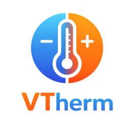

# Versatile Thermostat Poêle à Pellets
[](https://github.com/hacs/integration)
[](https://github.com/jmcollin78/vtherm_pellet_stove/releases)
[](LICENSE)
[Read the English version](README.md)

<p align="center">
  
</p>

<p align="center">
  <strong>Plugin de régulation pour poêle à pellets — Versatile Thermostat</strong>
</p>

<p align="center">
  Pilotez votre poêle à pellets avec un algorithme de régulation adapté à ses contraintes physiques : temps d'allumage long, niveaux de puissance, protection anti-court-cycle et coupure de sécurité.
</p>

---

## Qu'est-ce que vtherm_pellet_stove ?

`vtherm_pellet_stove` enregistre un nouvel algorithme proportionnel nommé **`pellet_regulation`** dans l'API publique de [Versatile Thermostat](https://github.com/jmcollin78/versatile_thermostat) (VTherm). Il étend les thermostats VTherm configurés en mode `over_switch` ciblant exactement une entité `climate` avec phase de brûleur exploitable, ou un `switch` bistable en contact sec local explicitement configuré.

> Issue #9 : le contact sec et le suivi commun des compteurs sont implémentés sur cette branche de développement, pas encore publiés ni qualifiés sur poêle réel. ON ne prouve pas l'allumage ; après OFF, le refroidissement est seulement présumé. Un cooldown trop court peut autoriser un rallumage pendant le refroidissement. Voir le [guide](documentation/fr/vtherm_pellet_stove.md) et les [résultats/limites de validation](documentation/tech-docs/issue-9-review.md).

Fonctionnalités principales :

- **Hystérésis paramétrable** — seuils `hysteresis_on` / `hysteresis_off` configurables.
- **Protection anti-court-cycle** — durées minimales de marche/arrêt et délai de refroidissement pour protéger la bougie.
- **Coupure de sécurité** — force l'extinction si la température ambiante dépasse un seuil configurable.
- **Pilotage optionnel du niveau de puissance** — ajuste `fan_mode` ou `preset_mode` du poêle en fonction de ΔT et de la pente de température.
- **Boost** — hausse temporaire au niveau maximal après une augmentation de consigne.
- **État persistant** — survit aux redémarrages de Home Assistant.
- **Compatible HACS** — entrée de defaults globaux + surcharges par thermostat.

## Intégration avec Versatile Thermostat

Le plugin utilise l'API publique [vtherm_api](https://github.com/KipK/vtherm_api). Une fois installé :

1. Configurer Versatile Thermostat en mode **`over_switch`**.
2. Choisir un seul sous-jacent : le `climate.*` du poêle ou un relais `switch.*` bistable.
3. Pour `climate`, configurer `vswitch_on = "set_hvac_mode/hvac_mode:heat"` et `vswitch_off = "set_hvac_mode/hvac_mode:off"`. Pour le relais standard, conserver `turn_on`/`turn_off`.
4. Sélectionner **`pellet_regulation`** comme fonction proportionnelle.
5. Pour le contact sec, ajouter une entrée Pellet Stove propre au VTherm, sélectionner ce mode, lire l'avertissement et confirmer la bistabilité avant de valider les durées. Puissance et boost sont inopérants dans ce mode.

## Installation

### Via HACS (recommandé)

[](https://my.home-assistant.io/redirect/hacs_repository/?owner=jmcollin78&repository=vtherm_pellet_stove&category=Integration)

1. Ajouter ce dépôt dans HACS comme intégration personnalisée.
2. Installer **Versatile Thermostat Poêle à Pellets**.
3. Redémarrer Home Assistant.
4. Ajouter l'intégration depuis **Paramètres → Appareils et services**.

### Installation manuelle

1. Copier `custom_components/vtherm_pellet_stove` dans le dossier `custom_components` de HA.
2. Redémarrer Home Assistant.
3. Ajouter l'intégration depuis **Paramètres → Appareils et services**.

## Réinitialiser la régulation pellet

Pour une récupération exceptionnelle, appeler `vtherm_pellet_stove.reset` depuis **Outils de développement > Actions**, en ciblant exactement un VTherm utilisant `pellet_regulation` :

```yaml
action: vtherm_pellet_stove.reset
data:
  entity_id: climate.votre_vtherm_pellet
```

L'action passe le VTherm sur OFF, puis efface son statut logiciel de chauffe, les dates de transition, le boost et l'historique du niveau de puissance. Le capteur de diagnostic affiche immédiatement `off` et `next_action_allowed_at: null`. Le reset est sauvegardé pour le prochain redémarrage de Home Assistant. Le VTherm reste sur OFF ; le remettre manuellement sur HEAT au moment approprié. La configuration, les seuils de sécurité thermique et l'énergie cumulée sont conservés.

**Attention :** cette action supprime volontairement les délais logiciels d'arrêt minimal et de refroidissement, dès le succès de la commande d'arrêt. Elle n'attend pas le refroidissement physique, ne réinitialise pas les défauts du poêle et ne contourne pas ses protections matérielles. Vérifier que le poêle peut redémarrer sans risque avant de sélectionner HEAT. Si l'arrêt échoue ou si le VTherm refuse OFF, l'historique de régulation n'est pas effacé. Une erreur de sauvegarde est signalée car le reset pourrait ne pas survivre à un redémarrage. Aucun autre thermostat n'est commandé.

## Documentation

- 🇬🇧 [User documentation](documentation/en/vtherm_pellet_stove.md)
- 🇬🇧 [Technical documentation](documentation/en/technical_doc.md)
- 🇫🇷 [Documentation utilisateur](documentation/fr/vtherm_pellet_stove.md)
- 🇫🇷 [Documentation technique](documentation/fr/technical_doc.md)

## Architecture

Voir [tech-docs/plugin-architecture.md](tech-docs/plugin-architecture.md) pour le document d'architecture détaillé.

## Auteur

- [@jmcollin78](https://github.com/jmcollin78)

## Licence

MIT — voir [LICENSE](LICENSE).
