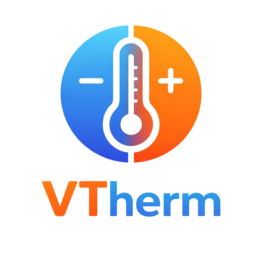

# Versatile Thermostat Pellet Stove

[](https://github.com/hacs/integration)
[](https://github.com/jmcollin78/vtherm_pellet_stove/releases)
[](LICENSE)

[Lire la version française](README.fr.md)

<p align="center">
  
</p>

<p align="center">
  <strong>Pellet stove proportional regulation plugin for Versatile Thermostat</strong>
</p>

<p align="center">
  Control your pellet stove with a regulation algorithm tailored to its physical constraints — long ignition times, power levels, anti-short-cycle protection, and safety cut-offs.
</p>

---

## What is vtherm_pellet_stove?

`vtherm_pellet_stove` registers a new proportional algorithm named **`pellet_regulation`** in the [Versatile Thermostat](https://github.com/jmcollin78/versatile_thermostat) (VTherm) API. It extends VTherm `over_switch` thermostats targeting exactly one `climate` entity with a usable burner phase, or one bistable `switch` in explicitly configured local dry-contact mode.

> Issue #9: dry contact and shared active counters are implemented on this development branch, not yet released or qualified on real stove hardware. ON does not prove ignition; after OFF, cooling is only presumed. A cooldown that is too short may allow restarting while the stove is still cooling. See the [guide](documentation/en/vtherm_pellet_stove.md) and [validation results/limits](documentation/tech-docs/issue-9-review.md).

Key features:

- **Parameterizable hysteresis** — configurable `hysteresis_on` / `hysteresis_off` thresholds.
- **Anti-short-cycle protection** — minimum on/off durations and cooldown delay keep the igniter safe.
- **Safety cut-off** — forces the stove off when the room temperature exceeds a configurable threshold.
- **Optional power level control** — adjusts `fan_mode` or `preset_mode` on the underlying climate entity based on `ΔT` and temperature slope.
- **Boost** — temporarily raises power to maximum after a setpoint increase.
- **Persistent state** — survives Home Assistant restarts.
- **HACS-compatible** — global defaults entry + per-thermostat overrides.

## Integration with Versatile Thermostat

The plugin relies on the public [vtherm_api](https://github.com/KipK/vtherm_api). Once installed:

1. Configure Versatile Thermostat in **`over_switch`** mode.
2. Select exactly one underlying: the stove `climate.*` or a bistable relay `switch.*`.
3. For `climate`, configure `vswitch_on = "set_hvac_mode/hvac_mode:heat"` and `vswitch_off = "set_hvac_mode/hvac_mode:off"`. For a standard relay, keep `turn_on`/`turn_off`.
4. Select **`pellet_regulation`** as the proportional function.
5. For dry contact, add a local Pellet Stove entry for the VTherm, select this mode, read the warning and confirm bistability before saving durations. Power and boost are inactive in this mode.

## Installation

### Via HACS (Recommended)

[](https://my.home-assistant.io/redirect/hacs_repository/?owner=jmcollin78&repository=vtherm_pellet_stove&category=Integration)

1. Add this repository to HACS as a custom integration.
2. Install **Versatile Thermostat Pellet Stove**.
3. Restart Home Assistant.
4. Add the integration from **Settings → Devices & Services**.

### Manual installation

1. Copy `custom_components/vtherm_pellet_stove` to your HA `custom_components` directory.
2. Restart Home Assistant.
3. Add the integration from **Settings → Devices & Services**.

## Reset pellet regulation

For exceptional recovery, call `vtherm_pellet_stove.reset` from **Developer Tools > Actions** with exactly one VTherm using `pellet_regulation`:

```yaml
action: vtherm_pellet_stove.reset
data:
  entity_id: climate.your_pellet_vtherm
```

The action switches the VTherm to OFF, then clears its software heating status, transition timestamps, boost and power-level history. The diagnostic sensor immediately shows `off` and `next_action_allowed_at: null`. The reset is saved for the next Home Assistant restart. The VTherm remains OFF; switch it back to HEAT manually when appropriate. Configuration, temperature safety thresholds and accumulated energy are preserved.

**Warning:** this deliberately removes software minimum-off and cooldown delays, immediately after the stop command succeeds. It does not wait for physical cooling, reset stove faults or override hardware protections. Ensure the stove is safe to restart before selecting HEAT. If the stop fails or the VTherm refuses OFF, the regulation history is not cleared. A save failure is reported because the reset might not survive a restart. No command is sent to unrelated thermostats.

## Documentation

- 🇬🇧 [User documentation](documentation/en/vtherm_pellet_stove.md)
- 🇬🇧 [Technical documentation](documentation/en/technical_doc.md)
- 🇫🇷 [Documentation utilisateur](documentation/fr/vtherm_pellet_stove.md)
- 🇫🇷 [Documentation technique](documentation/fr/technical_doc.md)

## Architecture

See [tech-docs/plugin-architecture.md](tech-docs/plugin-architecture.md) for the full design document.

## Authors

- [@jmcollin78](https://github.com/jmcollin78)

## License

MIT — see [LICENSE](LICENSE).
