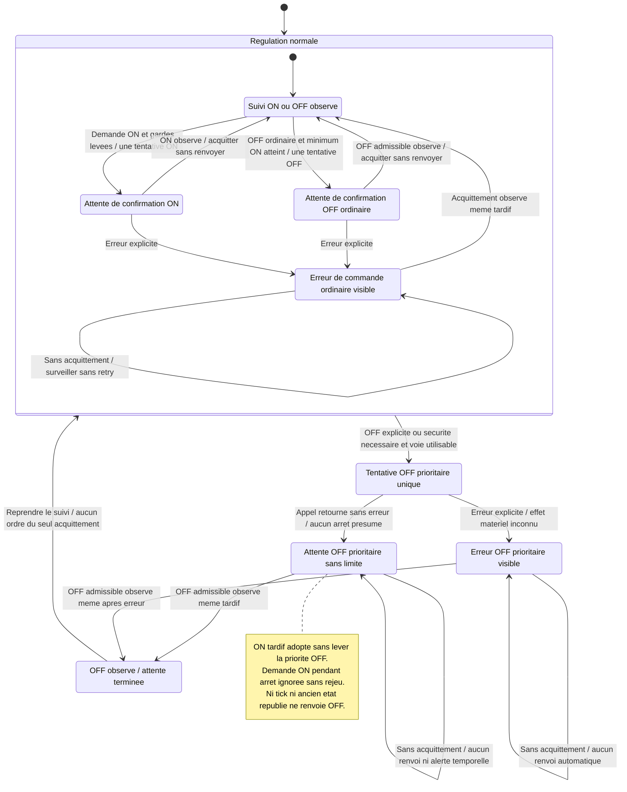
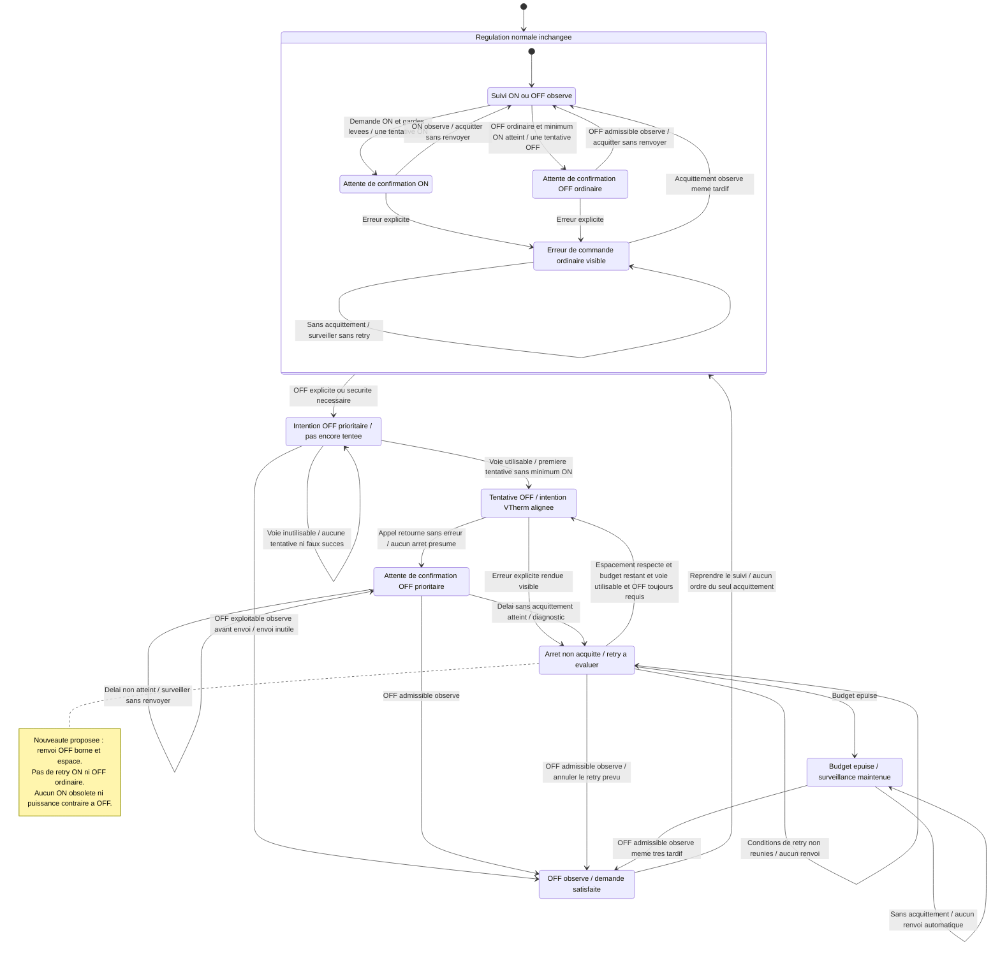

# Revue de l'issue #12 : transmission et suivi de l'arret prioritaire

## Statut et decision utilisateur

Decision du 2026-11-10 : **developpements mis en attente a la demande de
l'utilisateur**. L'approche issue de #9, actuellement en beta test, et les
extensions envisagees dans cette revue sont jugees trop complexes. La demande
est de revoir l'ensemble pour rechercher une solution beaucoup plus simple et
comprehensible par un humain, pas d'ajouter de nouveaux mecanismes a ce stade.

**Aucune poursuite de specification, conception ou implementation n'est
autorisee.** Aucun choix de retry ou de correction seule n'est valide. Les
propositions, graphes, alternatives et criteres ci-dessous sont conserves comme
historique d'analyse, non comme solution retenue ou plan a executer. Toute reprise
necessitera une demande explicite et les validations du processus de revue.

Le defaut de transmission OFF reste etabli dans le code consulte. La complexite
est le motif de remise en question de l'approche ; l'origine exacte de l'allumage
nocturne et sa chaine causale complete ne sont pas demontrees par les elements
disponibles. La suspension ne constitue ni une correction ni une autorisation de
remise en service. Seul ce rapport est mis a jour ; aucun code, configuration,
dependance ou environnement Home Assistant n'est modifie.

## Reference et resume

- Issue : [jmcollin78/vtherm_pellet_stove#12](https://github.com/jmcollin78/vtherm_pellet_stove/issues/12),
  "[Safety] Priority OFF can become pending without sending a stop command".
  Ouverte lors de la consultation, auteur `jmcollin78`, aucun commentaire,
  etiquette, responsable, jalon, relation ou PR liee affiche. L'activite reference
  le commit [e63b920](https://github.com/jmcollin78/vtherm_pellet_stove/commit/e63b92010f2f244aec725a3b86e1ed2b3bfebc6c),
  qui ajoute l'analyse. L'absence de doublon n'est pas etablie exhaustivement.
- Environnement rapporte : plugin `2.0.0.beta3`, HA `2026.11.0`, VTherm `10.6.4`,
  Duepi_EVO adapte a cette version HA ; VTherm `over_switch` avec commandes
  virtuelles `climate.set_hvac_mode` `heat`/`off`, reparation interne active,
  keep-alive desactive, puissance du plugin desactivee, minima ON/OFF 120/90 min,
  cooldown 5 min, securite ambiante 26 C.
- Quand VTherm est OFF et le poele observe ON, le controleur demande OFF ; le
  handler positionne `pending="OFF"` sans emprunter une branche d'envoi. Cet etat
  empeche une nouvelle decision OFF tant qu'aucun acquittement observe ne le leve.
- Incident rapporte : VTherm OFF le 9 novembre a 23:46:21, bruleur `Off` a
  23:52:31, avertissement de reparation a 23:55:37, puis `Ignition starting` a
  23:56:37, toujours avec VTherm OFF. Heures Europe/Paris UTC+01:00.
  L'avertissement n'indique pas le sens de la commande. `heat` pendant
  `Cooling down` ne prouve pas un allumage ; la phase d'ignition est ici decisive.

## Sources et elements verifies

Revision locale : `e63b92010f2f244aec725a3b86e1ed2b3bfebc6c`, soit
`2.0.0.beta3-1-ge63b920`. La comparaison Git avec `2.0.0.beta3` ne montre aucune
difference pour le handler et le controleur du plugin. Cela n'identifie pas les
fichiers effectivement charges par le processus HA distant.

| Source consultee                                                                          | Element etabli et limite                                                                                                                                                                                                                                   |
| ----------------------------------------------------------------------------------------- | ---------------------------------------------------------------------------------------------------------------------------------------------------------------------------------------------------------------------------------------------------------- |
| Issue GitHub : description, commentaires retournes, activite et metadonnees de la page    | Demande, criteres et incident tels que rapportes ; pas d'acces independant aux journaux distants.                                                                                                                                                          |
| [Analyse fournie](../en/issue-priority-off-dispatch.md)                                   | Reproduction hors ligne annoncee avec controleur reel, methode du handler extraite par AST et sorties simulees ; pas un essai materiel ou une integration HA complete.                                                                                     |
| [Handler du plugin](../../custom_components/vtherm_pellet_stove/handler.py#L549)          | `pending` est affecte avant l'envoi. OFF direct exige notamment `not state.is_heating` ; l'autre branche exige un HVAC different de OFF. Un poele observe ON avec HVAC OFF satisfait aucune des deux. L'annulation du scheduler est tout de meme demandee. |
| [Controleur](../../custom_components/vtherm_pellet_stove/pellet/controller.py#L350)       | `calculate_observed()` priorise HVAC OFF ou le seuil de securite, sans minimum ON ; `pending == "OFF"` supprime ensuite une nouvelle decision.                                                                                                             |
| [Etat et persistance](../../custom_components/vtherm_pellet_stove/pellet/state.py)        | `pending`, `off_priority` et `command_error` sont sauvegardes. Une observation concordante acquitte la demande ; aucune distinction persistante intention/tentative/envoi n'existe dans ce modele.                                                         |
| [Tests du handler](../../tests/test_handler.py)                                           | Couverture de ON en attente supplante par OFF, indisponibilite, erreurs, acquittement tardif et absence de repetition. Les cas consultes ne verifient pas un envoi reel pour HVAC OFF avec poele deja observe en chauffe.                                  |
| [Scheduler VTherm local](../../custom_components/versatile_thermostat/cycle_scheduler.py) | Chemin distinct de calcul/transmission et annulation de cycle ; sa source locale ne suffit pas a qualifier le contrat de la version deployee.                                                                                                              |
| [Revue #9](issue-9-review.md)                                                             | Arbitrages precedents : observation distincte de la demande, priorite OFF, attente sans expiration et sans retry automatique, y compris apres erreur. #12 demande de revoir une partie de cette derniere politique.                                        |
| [Configuration des tests](../../pyproject.toml)                                           | Tests existants dans `tests`, execution asyncio automatique, Python minimal declare 3.13. Cela ne prouve pas la compatibilite avec l'environnement rapporte.                                                                                               |

Verification realisee pour cette revue : consultation du code et comparaison Git.
La reproduction fournie n'a pas encore ete reexecutee pour ce rapport ; aucun
test HA, service reel ou essai de poele n'a ete lance. Les resultats historiques
de #9 ne sont pas presentes comme une validation de #12.

## Analyse de pertinence

**Fait verifie dans le code :** la combinaison HVAC OFF, observation ON,
`pending` initialement absent, cible valide et scheduler disponible conduit a
memoriser OFF sans appel a `turn_off()` ni a `start_cycle()`. Ce n'est pas une
attente du minimum ON : la decision OFF a deja ete prise. Une exception de
dispatch peut egalement laisser `pending="OFF"` bloquer les evaluations suivantes.

**Hypothese a qualifier :** une intention ON obsolete dans le sous-jacent peut
permettre a la reparation VTherm de contredire l'arret du plugin. Le chemin
supporte pour synchroniser cette intention et son comportement sur VTherm 10.6.4
doivent etre verifies avant de figer la conception. Aucun lien causal complet
avec l'allumage nocturne n'est etabli.

**Valeur attendue :** rendre l'arret utilisateur/securite effectivement tente,
observable et recuperable sans masquer l'etat constate ni provoquer de rafale de
commandes. Faisabilite locale apparente pour la correction de branche ; garanties
sur reparation, commandes differees et livraison materielle encore a qualifier.

## Perimetre precedemment propose (non retenu en l'etat)

1. Garantir un chemin de transmission OFF prioritaire pour la cible unique valide
   deja liee, y compris poele ON, ignition, ON en attente et indisponibilite lorsque
   l'adaptateur permet encore une tentative. Un scheduler absent ou une cible
   invalide ne doit pas produire un faux succes ; ne pas choisir une autre cible.
2. Distinguer intention, tentative/envoi et acquittement observe. Une branche non
   executee ou une erreur doit laisser la demande d'arret recuperable et une
   explication visible. Le retour d'un service ne prouve pas l'arret du poele.
3. Synchroniser l'intention OFF via un contrat VTherm supporte et testable, sans
   ecriture opportuniste dans un attribut prive ni simple appel HA hors contrat.
   Verifier l'annulation des callbacks et la neutralisation du ON precedent et
   des mises a jour de puissance tant que OFF reste prioritaire.
4. Specifier des retries **OFF prioritaires uniquement**, bornes et espaces, avec
   diagnostic si l'arret reste non acquitte. Proposition soumise a validation :
   cette exception remplace les seules regles incompatibles de #9 ; ne pas
   generaliser aux ON ou aux arrets ordinaires. Delais, budget, epuisement et
   reprise apres reconnexion/redemarrage restent a definir.
5. Conserver les acquittements selon le modele d'observation existant, les minima
   ON/OFF, le cooldown, la persistance des compteurs, le mode contact sec et le
   pilotage de puissance quand il est autorise. Ne jamais fabriquer une transition
   physique a l'envoi. OFF signifie l'arret normal de l'appareil, pas une coupure
   electrique pendant combustion ou refroidissement.
6. Completer les modules de tests existants du handler/controleur et, si necessaire,
   de l'etat ; mettre a jour les documents FR/EN et le changelog lors de la livraison.

Exclus : modification Duepi_EVO, firmware, materiel ou instance HA ; modification
du coeur VTherm dans ce depot ; suppression de ses protections ; refonte generale
des cycles ou de la configuration ; retry ON ; affirmation d'une cause de
l'allumage initial ; publication, deploiement ou autorisation de remise en service.
Un eventuel ticket compagnon VTherm pour interdire un repair ON avec parent OFF
est une recommandation distincte ; son existence et sa reference sont inconnues.

## Impacts et risques

### Comparaison des politiques #9 et #12

**La correction de l'absence d'envoi OFF ne change pas l'intention de #9.** #9
exigeait deja une tentative OFF prioritaire quand la commande est possible,
meme pendant minimum ON ou attente ON. Le defaut actuel viole cette intention :
`pending="OFF"` ne doit pas remplacer la tentative elle-meme.

**Le changement de politique propose est de retenter un OFF prioritaire deja
tente mais non acquitte, ou ayant remonte une erreur**, et de diagnostiquer une
absence d'acquittement apres un delai. #9 demandait au contraire de surveiller
sans renvoi automatique ni alerte due au seul temps ecoule.

Referentiel de comparaison : [specifications finales #9](../fr/issue-9-specifications.md#L117),
FR-006/009/010, BR-003/004 et AC-008/020/025/026/027/031, ainsi que la
[conception #9](issue-9-design.md#L123). "Intention initiale" designe ici le
comportement valide de #9, pas son implementation defectueuse.

Les deux graphes sont des **vues fonctionnelles simplifiees**, pas une conception
de #12 deja approuvee. Ils separent les etats de demande/attente des observations
ON/OFF ; aucun envoi ne transforme a lui seul l'etat observe. La branche
prioritaire suppose un arret necessaire pour une cible unique valide. Les
erreurs des commandes ordinaires restent sans retry dans les deux graphes.

#### Avant : intention validee dans #9

L'absence de fleche de retour vers `Envoi9` est intentionnelle : **pas de retry
automatique de la meme demande deja tentee**, meme si le poele reste observe ON.
Une nouvelle decision justifiee et distincte n'est pas un renvoi periodique du
seul fait de l'attente. Si aucune voie n'est utilisable, #9 ne garantit pas la
livraison : la priorite est conservee, l'observation surveillee et aucune execution
n'est pretendue. Le schema ne fixe pas un mecanisme de premiere tentative differee.

#### Apres : proposition de la review #12, non validee

Les etats `Retry12` et `Epuise12` sont des sous-etats de suivi d'une demande
**non acquittee**, pas des preuves d'echec physique ou d'arret. Le budget borne
les emissions automatiques, **pas la duree de surveillance**. Une observation
admissible termine l'attente, meme apres erreur ou epuisement, sans intervention
manuelle imposee par le seul historique. Les valeurs des delais/budgets, leur
rearmement et le traitement d'une levee de priorite sans acquittement restent
ouverts en Q12-02 ; aucune transition supplementaire n'est arbitree ici.

#### Ce qui change, et ce qui ne change pas

| Situation                                                       | Intention #9                                                        | Proposition #12                                                            | Nature de l'impact                                                         |
| --------------------------------------------------------------- | ------------------------------------------------------------------- | -------------------------------------------------------------------------- | -------------------------------------------------------------------------- |
| VTherm OFF, poele observe ON, aucune tentative OFF              | Tenter l'arret prioritaire lorsque possible                         | Meme exigence ; ne pas enregistrer un envoi qui n'a pas eu lieu            | Correction du bug, pas changement de politique.                            |
| OFF prioritaire deja tente, observation toujours ON sans erreur | Surveiller sans limite, sans renvoi ni alerte temporelle            | Diagnostic apres delai puis renvois limites si OFF reste requis            | Changement de BR-004 et AC-020, avec exception ciblee a FR-006 et AC-008.  |
| Erreur explicite sur une tentative OFF prioritaire              | Erreur visible et surveillance, sans retry                          | Erreur visible, surveillance et retry limite si possible et necessaire     | Exception ciblee a FR-009 et AC-025.                                       |
| Plus aucune tentative automatique autorisee par le budget       | Aucun budget necessaire puisqu'aucun retry                          | Diagnostic de budget epuise, surveillance et acquittement tardif conserves | Nouveau suivi, pas nouvelle garantie physique ni arret de la surveillance. |
| Absence de voie de commande puis reconnexion                    | Pas de livraison pretendue ; reconcilier au retour                  | Distinguer jamais tente/deja tente ; reevaluer avant toute emission        | Premiere tentative non equivalente a un retry ; rearmement a preciser.     |
| OFF admissible observe, dont phase non chauffante reconnue      | Terminer l'attente immediatement, aucun renvoi du seul acquittement | Identique ; annuler tout retry devenu inutile                              | AC-019/021/022/031 preserves.                                              |
| ON en attente supplante par OFF, minimum ON non atteint         | OFF prioritaire ; ON tardif ne le leve pas                          | Identique, avec chemin d'envoi et intention VTherm a fiabiliser            | FR-010 et AC-026 preserves, pas une nouvelle priorite.                     |
| ON ou OFF ordinaire en attente ou en erreur                     | Pas de retry automatique                                            | Identique                                                                  | Aucun retry generalise aux cycles ordinaires.                              |

**Invariants communs aux deux graphes :**

- ON exige une demande courante, toutes les gardes levees, aucun arret en cours
   et aucune priorite OFF applicable. Cela inclut minimum OFF plus cooldown et les
   protections de phases `climate`. Une demande ON refusee n'est jamais memorisee
   pour etre rejouee ; le retour au suivi n'annule pas a lui seul la priorite OFF.
- Les compteurs partent de l'observation, jamais de l'envoi. La premiere observation
   etablissant le cycle OFF initialise ses compteurs ; une phase stable ou une
   progression normale ne les reinitialise pas. OFF observe n'est pas une preuve
   de refroidissement physique termine ni une permission ON immediate.
- Observation inexploitable : `unavailable`, suspension des compteurs et decisions
   ordinaires, surveillance sans limite. OFF prioritaire peut etre tente si la voie
   reste utilisable ; aucune livraison ni extinction n'est deduite de cet essai.
- Au retour, au redemarrage ou apres manoeuvre externe : reprendre les compteurs
   concordants, sinon adopter l'etat constate et initialiser ceux du nouveau cycle,
   sans temps inconnu ni ordre de seule reconciliation. Un retry #12 eventuel est
   une decision distincte, justifiee par OFF encore requis et les conditions du retry.

**Exemple concret :** VTherm OFF, `Flame On` observe, tentative OFF reellement
effectuee, mais le prochain polling expose encore `Flame On`. Avec #9, ce seul
retard ne provoque aucun second OFF ni alerte temporelle. Avec la proposition #12,
aucun renvoi immediat non plus ; si l'absence d'acquittement dure au-dela du delai
retenu, un autre OFF peut etre tente, sous budget et espacement. Si `Cooling down`
ou un autre acquittement admissible arrive avant cette tentative, elle est annulee.
Un ancien etat publie ne prouve dans aucun des deux cas que le premier OFF a echoue.

**Choix possible sans changer la politique #9 :** corriger l'envoi initial,
clarifier son suivi et synchroniser l'intention OFF, tout en conservant l'absence
de retries et d'alerte temporelle. Cette option ne satisfait pas integralement
les demandes de retry/diagnostic de #12 : elle demande une reduction explicite du
perimetre de l'issue, pas l'abandon de sa correction principale. Aucun de ces
choix n'est valide par la seule demande de comparaison graphique.

### Risques et mesures

| Risque ou impact                                                                | Gravite                  | Probabilite / evidence                                                                   | Mesure proposee                                                                                             |
| ------------------------------------------------------------------------------- | ------------------------ | ---------------------------------------------------------------------------------------- | ----------------------------------------------------------------------------------------------------------- |
| Arret utilisateur non envoye alors que le poele fonctionne                      | Elevee, surete thermique | Deterministe sous les preconditions du defaut local ; frequence en exploitation inconnue | Voie OFF explicite, preuve d'appel et test de regression.                                                   |
| ON differe, repair ou puissance contredisant OFF                                | Elevee                   | Plausible ; origine de l'incident non prouvee                                            | Synchroniser intention et ordre logique ; tests avec adaptateur/scheduler VTherm reels et services simules. |
| Rafale OFF, reinitialisation ou interaction indesirable pendant refroidissement | Elevee selon appareil    | Indeterminee ; depend du contrat de l'adaptateur                                         | Espacement et budget explicites, arret des retries sur acquittement, validation du comportement repete.     |
| Etat indisponible ou erreur presentes comme un arret acquis                     | Elevee                   | Modele de commande actuellement ambigu                                                   | Diagnostic distinct, observation conservee, reconciliation au retour.                                       |
| Attente OFF obsolete restauree apres reload/restart                             | Elevee                   | `pending` est persiste ; effet exact a tester                                            | Compatibilite des snapshots existants, aucune presomption d'envoi reussi, aucune reprise ON obsolete.       |
| Regression contact sec, minima, cooldown, puissance ou ON one-shot              | Moyenne a elevee         | Plausible pour un chemin commun                                                          | Non-regression des deux modes dans les tests existants.                                                     |
| Confusion avec l'ancienne politique #9                                          | Moyenne                  | Contradiction documentaire constatee                                                     | Evolution explicitement approuvee et tracee, limitee a OFF prioritaire.                                     |

Compatibilite : ne pas relever les versions minimales ni modifier les identifiants
sans justification validee. Le contrat VTherm/vtherm-api requis doit etre confirme
sur les versions cibles ; si aucune voie supportee n'est disponible, remonter le
blocage plutot qu'etendre silencieusement le perimetre au coeur VTherm.

Migration : les anciens snapshots peuvent contenir un OFF dont l'envoi est inconnu.
La conception doit definir leur reprise sans inventer livraison, dates physiques
ou credit de duree. Aucune migration n'est prescrite arbitrairement a ce stade.

Exploitation et confidentialite : exposer dernier essai, cause de l'arret,
erreur, attente et epuisement du budget sans secrets ni export de donnees par
defaut. Pas de flux externe nouveau prevu. La securite physique, non un risque
d'authentification demontre, constitue l'enjeu principal.

## Alternatives examinees

| Option                                                                                       | Avantage                                                                         | Limite / recommandation                                                                                         |
| -------------------------------------------------------------------------------------------- | -------------------------------------------------------------------------------- | --------------------------------------------------------------------------------------------------------------- |
| Corriger l'envoi et son suivi, synchroniser l'intention OFF, sans retry ni alerte temporelle | Retablit la priorite OFF deja voulue dans #9 sans changer sa politique d'attente | Ne satisfait pas les demandes de retry/diagnostic temporel de #12 ; perimetre reduit a approuver explicitement. |
| Corriger transmission, intention et suivi OFF avec retries limites                           | Couvre la demande complete                                                       | Recommande, sous reserve d'arbitrer l'evolution de #9 et de qualifier le contrat VTherm.                        |
| Faire de tout `cancel_cycle()` un arret                                                      | Simple en apparence                                                              | Ecarte : le plugin annule aussi apres un ON one-shot intentionnel.                                              |
| Appeler directement le service HA sans synchroniser VTherm                                   | Peut emettre OFF                                                                 | Ecarte comme solution complete : laisse potentiellement une intention ON concurrente.                           |
| Desactiver repair ou modifier Duepi                                                          | Peut masquer une voie concurrente                                                | Ne corrige pas l'absence d'envoi OFF ; ni correctif suffisant ni preuve de remise en service sure.              |

## Decisions et questions ouvertes

- **Q12-01, arbitrage fonctionnel :** approuver l'exception aux regles #9 pour
  retries limites et diagnostic d'absence d'acquittement des seuls OFF prioritaires ?
  Le texte de #12 la demande, mais ne remplace pas a lui seul une validation du
  rapport et des futurs resultats de convergence.
- **Q12-02, a specifier :** delai d'acquittement, intervalle/backoff, nombre maximal
  de tentatives, etat apres epuisement, maintien de la priorite et rearmement apres
  reconnexion ou reload. "Borne" ne permet pas de choisir arbitrairement ces valeurs.
- **Q12-03, preuve technique bloquante avant developpement :** chemin supporte
  synchronisant OFF et intention du sous-jacent, erreurs effectivement remontees,
  annulation des callbacks et interaction repair sur les versions cibles. Ne pas
  promettre l'annulation d'un ON deja livre au materiel.
- **Q12-04, inconnues non bloquantes pour la revue :** auteur de la commande
  d'allumage initiale, fichiers charges a distance, premiere version fautive et
  ticket compagnon VTherm. Les traces disponibles ne permettent pas de conclure.

## Processus anterieur et criteres envisages (suspendus)

Les etapes suivantes decrivent le processus envisage avant la decision de mise
en attente. Elles ne doivent pas etre engagees dans le cadre de cette suspension.

1. Obtenir l'approbation explicite du present rapport et l'autorisation de passer
   aux specifications et a la conception, notamment sur Q12-01.
2. Faire produire les specifications FR/EN par `Redacteur de specifications`, puis
   la conception par `Conception logicielle detaillee`. Faire relire les documents
   croises, trois cycles complets maximum ; tout desaccord persistant est soumis
   a l'utilisateur, sans choix arbitraire.
3. Exiger une tracabilite des dix criteres de l'issue : OFF en `Flame On` avant
   minimum ON ; ignition et securite ambiante ; priorite sur ON/callbacks/puissance ;
   aucune attente bloquante sans tentative ; erreurs/absence d'acquittement/
   indisponibilite/reconnexion avec retries limites ; acquittement OFF/refroidissement
   sans rafale ; intention repair OFF ; preservation minima/cooldown/puissance ;
   annulation apres ON sans arret induit ; tests existants completes avec services
   simules et aucun equipement physique commande.
4. Valider la politique de retry, la reprise des snapshots et la faisabilite du
   contrat VTherm. Les tests devront demontrer les appels reels des adaptateurs
   simules, pas seulement `pending`, `on_percent` ou l'appel d'un scheduler mocke.
   Qualifier ensuite les versions cibles ; tests locaux et acceptation materielle
   demeurent des niveaux de preuve differents.
5. Presenter les resultats de convergence et demander une nouvelle autorisation
   explicite de developpement. Ne deleguer alors qu'a l'agent
   `Developpement d'integrations Home Assistant`, avec perimetre et criteres valides.

**Jalon actuel : travaux suspendus sur decision utilisateur ; approche a
simplifier avant toute eventuelle reprise. Aucun developpement engage pour #12,
aucune delegation ni action sur un poele ou une instance HA.**