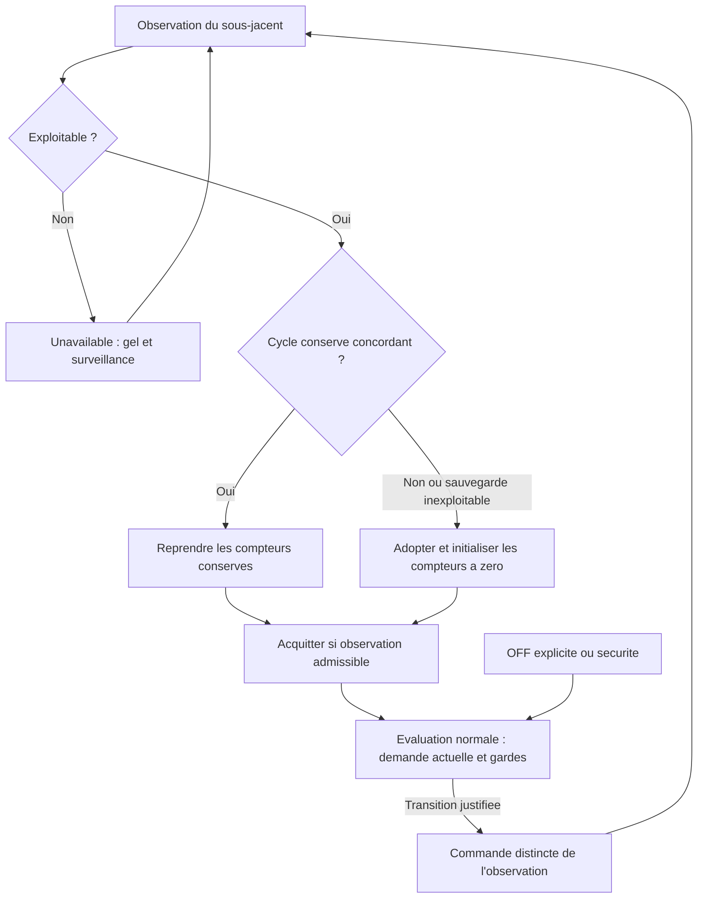

# Issue #9 - Conception technique / Technical Design

| Champ / Field                          | Valeur / Value                                                                                                                                                                                       |
| -------------------------------------- | ---------------------------------------------------------------------------------------------------------------------------------------------------------------------------------------------------- |
| Version                                | 0.8 - Alignement sur les specifications v1.8 / Alignment with v1.8 specifications                                                                                                                    |
| Date                                   | 2026-11-05                                                                                                                                                                                           |
| Statut / Status                        | Conception documentaire ; verification d'execution non realisee ; developpement non autorise / Documentary design; runtime verification not performed; implementation not authorized                 |
| Proprietaire / Owner                   | A designer / To be designated                                                                                                                                                                        |
| Sources normatives / Normative sources | [Specifications FR v1.8](../fr/issue-9-specifications.md), [EN v1.8 specifications](../en/issue-9-specifications.md), instruction utilisateur du present echange / user instruction in this exchange |
| Sources techniques / Technical sources | Lectures statiques locales ciblees, referencees ci-dessous / Targeted local static reads, linked below                                                                                               |

Cette revision remplace les cycles historiques et leurs reserves speculatives. Seul ce document bilingue est modifie, au chemin explicitement demande. Les specifications v1.8 prevalent ; la revue historique n'est pas normative. Aucun code, configuration, dependance, autre document ou environnement HA n'est modifie. Les composants et contrats sont proposes, non livres. La date de confirmation Q-009 n'est pas fournie.

This revision replaces historical cycles and speculative reservations. Only this bilingual document is changed, at the explicitly requested path. The v1.8 specifications prevail; the historical review is not normative. No code, configuration, dependency, other document or HA environment is changed. Components and contracts are proposed, not shipped. The Q-009 confirmation date was not provided.

## FR - Conception

### 1. Objectif, perimetre et decisions acquises

Concevoir le contact sec local explicite : poele, contact bistable confirme par l'utilisateur, une entite `switch`, VTherm `over_switch`, algorithme `pellet_regulation`, sans thermostat generique intermediaire. Tout VTherm Pellet Stove, y compris `climate`, a exactement un sous-jacent. Suivi, sauvegarde/reprise, reconciliation et attentes sont communs aux deux modes ; phases, protections et commandes propres a `climate` sont conservees.

La regle directrice est acquise : **la reconciliation fait toujours confiance a l'etat exploitable constate et expose par le sous-jacent**. Compteurs concordants : reprise ; divergence ou sauvegarde inexploitable : adoption et zero des compteurs correspondants au nouvel etat. Aucun temps inconnu, commande de seule reconciliation, blocage supplementaire, intervention utilisateur, historique suppose ou attente conservatrice. Les gardes ON et la priorite OFF explicite/securite restent applicables.

Sont exclus : plusieurs sous-jacents, `input_boolean`, impulsions, inversion materielle presumee, retour physique absent, nouveau delai, puissance/boost actifs en contact sec et modification VTherm/Duepi/firmware/poele. Les personnalisations ne sont pas exclues par leur seule presence : verifier leur contrat commande/etat, sans support general presume. Identifiants, options et resolution des autres reglages communs sont preserves. Aucun developpement autorise.

| Decision | Traduction dans la conception                                                                                                                                                                                                                                                   |
| -------- | ------------------------------------------------------------------------------------------------------------------------------------------------------------------------------------------------------------------------------------------------------------------------------- |
| Q-001    | Uniquement `min_on_duration_min`, `min_off_duration_min`, `cooldown_duration_min` ; conserver unites, valeurs et bornes existantes.                                                                                                                                             |
| Q-002    | Sauvegarder les compteurs actifs ; suspendre hors HA/indisponibilite ; reprendre selon concordance, sinon adopter/zero ; surveillance sans limite.                                                                                                                              |
| Q-003    | Adopter les manoeuvres et observations exploitables `switch` et `climate`, sans inverse de reconciliation ni acquittement utilisateur.                                                                                                                                          |
| Q-004    | Attente distincte, acquittement observe, erreur sans retry ; OFF explicite/securite prioritaire ; ON non conforme silencieux, sans memoire/rejeu.                                                                                                                               |
| Q-005    | Choix local explicite et avertissement FR/EN ; cible unique ; puissance/boost masques et neutralises, valeurs conservees.                                                                                                                                                       |
| Q-006    | `Cleaning` et `Eco idle` : non chauffants / non actifs, pas indisponibles par ce classement.                                                                                                                                                                                    |
| Q-007    | Apres commande OFF, chacune confirme la fin de chauffe, pas la fin physique du refroidissement.                                                                                                                                                                                 |
| Q-008    | Apres OFF, chacune acquitte OFF et termine immediatement son attente, meme tardivement ou apres erreur.                                                                                                                                                                         |
| Q-009    | Premiere observation de chacune etablissant le cycle OFF apres commande OFF : minimum OFF/cooldown a zero a l'observation, jamais a l'envoi ; cycle etabli sans reset sur stable/progression normale. Hors de ce contexte, reconciliation commune, sans etendre l'acquittement. |

### 2. Existant verifie et dependances

Aucune consigne HA/AppDaemon additionnelle n'a ete trouvee par recherche des fichiers `AGENTS.md` et `*instructions.md` du depot. Il s'agit d'une integration Home Assistant, sans application AppDaemon ajoutee. Utiliser les identifiants d'entite, non des identifiants d'appareil.

| Source locale relue                                                                                                                                          | Fait verifie et portee                                                                                                                                                                                                                                                                                                                                                                       |
| ------------------------------------------------------------------------------------------------------------------------------------------------------------ | -------------------------------------------------------------------------------------------------------------------------------------------------------------------------------------------------------------------------------------------------------------------------------------------------------------------------------------------------------------------------------------------- |
| [handler.py](../../custom_components/vtherm_pellet_stove/handler.py), `_physical_heating_state`, `_async_control_heating`                                    | Le classement courant ne lit que les `climate.*` ; un `switch` seul donne `None`, donc `allow_turn_on=False` est transmis au controleur. `Ignition starting` et `Cleaning` ne sont pas classes par cette methode. Ce chemin n'implemente pas le contrat cible.                                                                                                                               |
| [handler.py](../../custom_components/vtherm_pellet_stove/handler.py), controle et publication                                                                | Le verrou serialise les evaluations du handler. Une transition hors HVAC OFF appelle le scheduler puis annule le cycle ; HVAC OFF evite cet appel pour ne pas doubler la voie VTherm. Publication et sauvegarde existent ; leur presence ne prouve pas une observation ni l'absence de commandes ailleurs.                                                                                   |
| [underlyings.py](../../custom_components/versatile_thermostat/underlyings.py), `UnderlyingSwitch`                                                            | `turn_on/off` utilisent `hass.services.async_call` sans `blocking=True` et journalisent/absorbent `ServiceNotFound`. `set_hvac_mode` filtre OFF selon `is_device_active`. Initialisation, keep-alive et repair peuvent aussi commander selon leurs conditions. `build_command` tient compte d'inversion/commandes personnalisees. Limites du chemin, pas preuve d'une impossibilite globale. |
| [state.py](../../custom_components/vtherm_pellet_stove/pellet/state.py), [cycle_guard.py](../../custom_components/vtherm_pellet_stove/pellet/cycle_guard.py) | L'etat persiste des horodatages ON/OFF ; les gardes calculent du temps mural. Cela ne represente pas les compteurs actifs suspendus requis. Le handler instancie un `Store` et sauvegarde l'etat du controleur.                                                                                                                                                                              |
| [config_flow.py](../../custom_components/vtherm_pellet_stove/config_flow.py)                                                                                 | Points d'entree creation, Options et Reconfigurer identifies. Le parcours contact sec cible reste a verifier/implementer, non declare disponible.                                                                                                                                                                                                                                            |
| [client.py](../../custom_components/duepi_evo/client.py), [climate.py](../../custom_components/duepi_evo/climate.py)                                         | Decodage local des six phases du tableau ci-dessous ; `burner_status` est un attribut legacy annonce deprecated. `Cleaning` derive localement heat/heating ; `Eco idle` heat/idle. Ces derives ne remplacent pas le classement fonctionnel Q-006.                                                                                                                                            |
| [VTherm manifest](../../custom_components/versatile_thermostat/manifest.json), [Duepi manifest](../../custom_components/duepi_evo/manifest.json)             | Versions locales `10.6.3` et `2026.03.0` ; versions deployees et version HA cible non confirmees. Aucun identifiant de capteur de remplacement de phase n'est invente.                                                                                                                                                                                                                       |

Les constats sont statiques et limites aux chemins cites. Un retour de service n'est ni acquittement observe, ni preuve d'effet ou d'absence d'effet materiel. Le verrou du handler et l'annulation d'un cycle ne garantissent pas l'annulation d'une commande transmise ni l'ordre physique d'execution.

### 3. Composants et responsabilites proposes

| Composant                       | Entrees, responsabilite et sorties                                                                                                                                                                                                                                                                                                                                                                                                                  |
| ------------------------------- | --------------------------------------------------------------------------------------------------------------------------------------------------------------------------------------------------------------------------------------------------------------------------------------------------------------------------------------------------------------------------------------------------------------------------------------------------- |
| Configuration locale            | UID VTherm, liste des sous-jacents, type et options : valider cible unique ; choix contact sec explicite non preselectionne, confirmation bistable et avertissement FR/EN avant validation. Creation/Options/Reconfigurer ; annulation sans ecriture. Aucune propagation globale. Masquer puissance/boost sans effacer les valeurs brutes ; neutraliser leurs effets quelle que soit leur source ; retour explicite `climate` les rend disponibles. |
| Adaptateur d'observation        | Lecture initiale et suivi des changements de l'unique entite : produire etat brut, phase, famille temporelle, disponibilite et acquittement eventuel. Aucun HVAC demande ou retour de service utilise comme remplacement d'une phase.                                                                                                                                                                                                               |
| Etat de cycle et reconciliation | Restaurer avant regulation ; comparer le cycle conserve a l'observation exploitable, reprendre ou adopter/zero. Conserver les compteurs sur etat stable/progression normale ; geler seulement les intervalles non comptabilisables. Aucune commande issue de cette operation.                                                                                                                                                                       |
| Gardes et decision              | Demande actuelle, compteurs, observation et protections `climate` : autoriser une transition justifiee ; refus ON silencieux sans mutation ni intention differee. OFF explicite/securite contourne minimum ON et attente ON.                                                                                                                                                                                                                        |
| Adaptateur de commande          | Utiliser la voie du type cible ; distinguer decision, soumission, attente, erreur et acquittement observe ; eviter doublons/retry/rejeu sans supprimer les protections VTherm. Qualification des chemins effectifs au §9.                                                                                                                                                                                                                           |
| Persistance et diagnostic       | `Store` versionne par UID et diagnostic existant : sauvegarder les cumuls, restaurer avant decision, exposer observation/attente/erreur/reprise distinctes, sans renommer les identifiants existants.                                                                                                                                                                                                                                               |

L'adoption/acquittement ne commande rien. La derniere etape est une evaluation normale distincte ; OFF prioritaire est traite lorsque la voie de commande est utilisable, sans attendre une confirmation ON.

### 4. Entites, etats et correspondances de cycle

L'« etat reel constate » est l'etat exploitable expose a l'integration, non une mesure physique absente. La famille ON/OFF sert aux compteurs ; conserver la phase brute et les gardes distinctes. Mapping propose pour la source Duepi locale identifiee, a verifier sur les versions cibles :

| Observation                                                    | Famille temporelle / acquittement / limite                                                                                                                                                                                                                                                                                                                                                                                                                            |
| -------------------------------------------------------------- | --------------------------------------------------------------------------------------------------------------------------------------------------------------------------------------------------------------------------------------------------------------------------------------------------------------------------------------------------------------------------------------------------------------------------------------------------------------------- |
| `switch.on`                                                    | ON ; acquitte ON. Au demarrage, deja ON est adopte comme allume pour la regulation uniquement. Contact actif, sans preuve de flamme/chauffe.                                                                                                                                                                                                                                                                                                                          |
| `switch.off`                                                   | OFF ; acquitte OFF. Contact coupe et refroidissement presume, jamais refroidissement physique acheve garanti.                                                                                                                                                                                                                                                                                                                                                         |
| `Ignition starting`                                            | ON ; acquitte ON sans attendre la chauffe.                                                                                                                                                                                                                                                                                                                                                                                                                            |
| `Flame On`                                                     | ON ; acquitte ON meme sans demarrage observe. Pas d'age passe attribue.                                                                                                                                                                                                                                                                                                                                                                                               |
| `Cooling down`                                                 | OFF ; mapping local du `Cooldown` fonctionnel. Acquitte OFF immediatement ; refroidissement encore suivi, pas annonce acheve.                                                                                                                                                                                                                                                                                                                                         |
| `Off`                                                          | OFF ; acquitte OFF directement, sans `Cooling down` prealable ni duree passee inventee.                                                                                                                                                                                                                                                                                                                                                                               |
| `Cleaning` et `Eco idle`, chacune                              | Non chauffant/non actif ; rattachement temporel OFF pour l'adoption/reconciliation commune, phase conservee, sans equivalence physique a `Off`/`Cooldown`. Apres commande OFF : confirmation de fin de chauffe, acquittement OFF et fin immediate de l'attente selon Q-007/Q-008 ; depart des compteurs Q-009 si nouveau cycle. Hors de ce contexte, adopter/reconcilier aussi, sans inventer une commande ni etendre cet acquittement. Aucun acquittement ON deduit. |
| `unknown`, `unavailable`, absent, phase inconnue/non classable | Inexploitable : `unavailable`, gel et surveillance. HVAC `heat/off` seul ne remplace pas la phase. Une phase reconnue ne devient pas inexploitable du fait d'une reserve documentaire.                                                                                                                                                                                                                                                                                |

Correspondances temporelles proposees : `Ignition starting`/`Flame On` appartiennent au meme cycle ON ; `Cleaning`/`Eco idle`/`Cooling down`/`Off` au meme cycle OFF pour le comptage. Repetition et progression normale entre phases d'une meme famille conservent les compteurs ; changement ON/OFF initialise ceux du nouvel etat. A la reprise, meme famille exploitable et compteurs valides : concordance et reprise, meme si le libelle a progresse. Les phases restent distinctes pour les protections : ce regroupement n'autorise pas a contourner une garde de phase ni ne prouve un refroidissement acheve. Pas de condition de commande OFF prealable pour adopter une phase exploitable.

Etat propose par UID : cible et mode explicite ; observation brute/phase interpretee/famille `ON|OFF` ; disponibilite ; compteurs actifs ; `pending=NONE|ON|OFF` distinct ; priorite OFF explicite/securite ; raison de reprise ; derniere erreur explicite. Aucun etat supplementaire de risque historique ne conditionne l'adoption ou la permission ON. Une attente avec observation disponible ne signifie pas `unavailable`.

### 5. Contrats, temps actif et persistance

Les noms suivants decrivent des contrats internes proposes, pas des API/services HA deja disponibles.

| Contrat           | Entrees requises, resultat et erreurs                                                                                                                                                                                                                                                                                                                                                                                                                                                                                                                                                                                                                                                       |
| ----------------- | ------------------------------------------------------------------------------------------------------------------------------------------------------------------------------------------------------------------------------------------------------------------------------------------------------------------------------------------------------------------------------------------------------------------------------------------------------------------------------------------------------------------------------------------------------------------------------------------------------------------------------------------------------------------------------------------- |
| `validate_target` | UID, configuration VTherm et mode local. Exiger exactement une cible ; contact sec : `over_switch`, une entite `switch` ON/OFF, confirmation bistable utilisateur sans detection materielle. Valider creation/Options/Reconfigurer, setup/reload et modification ulterieure de configuration ; reverifier la cible avant commande. Zero/multiple/type hors contrat : refus sans choix arbitraire, conversion ou suppression d'options. Indisponibilite d'une cible structurellement valide : FR-009, pas exclusion definitive.                                                                                                                                                              |
| `observe`         | ID d'entite et etat expose : produire le classement du §4 et l'acquittement admissible. Observation idempotente : aucune commande ni remise a zero sur stable/progression normale. L'auteur externe n'a pas a etre identifie.                                                                                                                                                                                                                                                                                                                                                                                                                                                               |
| `reconcile`       | Observation exploitable, cycle conserve et compteurs valides : concordance => reprise ; sinon => adoption/zero du nouvel etat. Sans sauvegarde exploitable : meme adoption/zero. Aucun temps inconnu, ordre, attente supplementaire ou intervention. Acquitter immediatement une attente dont l'observation satisfait le contrat.                                                                                                                                                                                                                                                                                                                                                           |
| `decide`          | Demande actuelle, etat, durees applicables valides, gardes et priorite : ON seulement si toutes les gardes sont levees et aucun arret en cours. OFF ordinaire sous minimum ON ; OFF explicite/securite prioritaire sans ce minimum ni attente ON. Un refus ON ne change ni etat ni compteurs, ne cree ni alerte ni intention.                                                                                                                                                                                                                                                                                                                                                               |
| `submit`          | Cible valide et transition justifiee : une tentative, attente separee du dernier observe. Pas de repetition sur tick, polling stable, attente ou erreur. Retour sans observation : pas de succes suppose. Erreur effectivement remontee : consultable, surveillance maintenue sans retry ; observation tardive acquitte sans intervention. OFF en attente sans expiration/alerte temporelle ; aucun timeout ON ajoute.                                                                                                                                                                                                                                                                      |
| `save/load`       | Snapshot versionne sous la cle UID existante : cible/mode pour validation, famille/phase du cycle et cumuls actifs en secondes ; informations d'attente/priorite et erreur connues restent distinctes de l'etat observe et ne creent aucune commande de restauration. Valider version, rattachement a la cible et valeurs finies non negatives. Sauvegarder apres mise a jour du cycle et a l'arret propre, serialiser les ecritures/reloads ; charger avant regulation. Donnees absentes/inexploitables : adoption/zero, pas de calcul depuis des horodatages anciens. Les informations conservees ne peuvent prolonger une attente apres acquittement ni bloquer une reprise concordante. |

Compter uniquement les intervalles HA actifs avec observation exploitable, avec une reference monotone en memoire ; la recreer a la reprise. Sauvegarder les cumuls, pas une echeance murale. Les anciennes dates seules ne prouvent pas un cumul actif : ne pas les convertir en temps garanti. Une erreur de lecture/validation du snapshot est diagnostiquee sans empecher l'adoption prevue ; une erreur d'ecriture reste visible sans inventer de temps sauvegarde. Aucun contrat de durabilite materielle n'est etabli.

En ON, minimum avant OFF ordinaire : `elapsed_on_sec >= 60 * min_on_duration_min`. En OFF, `elapsed_off_sec` et `elapsed_cooldown_sec` partagent l'origine d'observation et les intervalles actifs, sans additionner deux fois le temps ; garde du prochain ON : `elapsed_off_sec >= 60 * (min_off_duration_min + cooldown_duration_min)`. `elapsed_cooldown_sec` est une vue du meme temps pour le diagnostic du refroidissement presume. Conserver les trois durees existantes, sans nouveau parametre. Pour `climate`, conserver en plus les protections des phases, sans deduire une permission de la seule famille OFF. Expiration = permission, jamais ordre.

### 6. Flux nominaux, erreurs, annulations et reprise

| Flux                                      | Traitement attendu                                                                                                                                                                                                                                                                                                                                                                                                                                                                      |
| ----------------------------------------- | --------------------------------------------------------------------------------------------------------------------------------------------------------------------------------------------------------------------------------------------------------------------------------------------------------------------------------------------------------------------------------------------------------------------------------------------------------------------------------------- |
| Demarrage/reload/retour de disponibilite  | Charger le cycle, lire l'etat ; inexploitable : geler et surveiller sans limite. Exploitable : adopter/reprendre selon §5, puis seulement evaluation normale. ON conserve 20/30 minutes et ON observe : 10 minutes restantes quelle que soit l'interruption. Aucune extinction par defaut ni commande de seul cycle de vie.                                                                                                                                                             |
| Divergence ou premiere observation        | ON conserve -> OFF : minimum OFF/cooldown a zero a l'observation ; OFF conserve -> ON : minimum ON complet depuis l'observation. Sauvegarde absente/invalide : meme adoption/zero. Aucun historique a reconstruire ni temps inconnu credite.                                                                                                                                                                                                                                            |
| Transition commandee                      | Gardes et demande actuelle -> tentative unique -> attente distincte -> observation admissible -> acquittement. L'envoi n'etablit pas le cycle cible ; seuls les intervalles du cycle effectivement observe comptent. Ancien etat republie : pas de reset, erreur presumee, manoeuvre externe presumee ou nouvelle commande.                                                                                                                                                             |
| OFF puis `Cleaning` ou `Eco idle`         | Pour chacune, meme tardivement/apres erreur : fin de chauffe confirmee, OFF acquitte et attente terminee immediatement. Si nouveau cycle OFF : deux compteurs a zero a cette observation, jamais a l'envoi, sans attendre une autre phase. Stable/progression vers `Cooling down`/`Off` : conserver les valeurs ; reprise concordante idem. Erreur precedente consultable, aucun retry/rejeu ON. Ni fin physique, permission ON, acquittement ON ou annulation de priorite OFF deduits. |
| Manoeuvre externe exploitable             | Adopter l'etat et les compteurs correspondants ; poursuivre normalement sous gardes, sans inverse pour retrouver l'ancien etat ni acquittement manuel. Cela vaut aussi pour les phases non chauffantes hors contexte de commande OFF.                                                                                                                                                                                                                                                   |
| Attente ou erreur explicite               | Sans confirmation OFF : surveillance indefinie, aucune expiration/alerte temporelle/repetition. Erreur ON/OFF : conserver observation et erreur, pas de retry periodique ; une observation pertinente tardive acquitte. Ne pas maintenir un blocage du seul fait de l'erreur historique.                                                                                                                                                                                                |
| OFF explicite/securite pendant attente ON | Priorite logique immediate ; aucune attente du minimum ON ou de l'acquittement ON. Demander OFF par la voie utilisable sans doublon avec OFF direct VTherm ; adopter une observation ON tardive sans restaurer l'intention ON ni annuler cette priorite. Ne promettre ni livraison pendant indisponibilite, ni annulation materielle, ni arret physique.                                                                                                                                |
| ON pendant arret/gardes                   | Ignorer silencieusement, sans mutation due au refus, file ou intention differee. Confirmation OFF et expiration ne rejouent rien. Seule une nouvelle evaluation conforme selon la demande actuelle peut commander ON.                                                                                                                                                                                                                                                                   |
| Annulation/validation de configuration    | Annulation du formulaire sans effet. Configuration devenue hors contrat : refus sans cible arbitraire, conserver identifiants/options et diagnostic. Revalider cible et contrat commande/etat ; ne pas pretendre commander une entite absente/non resolue. Une cible valide avec observation indisponible reste soumise a FR-009 et a OFF prioritaire si la voie est utilisable.                                                                                                        |

### 7. Securite, observabilite et contraintes

Le contact ON/OFF atteste l'etat expose du contact, non la flamme, l'allumage effectif ou la fin du refroidissement. L'utilisateur confirme la bistabilite et regle les durees selon le poele. Afficher l'avertissement FR/EN **avant** confirmation : ON sans preuve d'allumage, refroidissement seulement presume, cooldown trop court susceptible de permettre un rallumage pendant le refroidissement. Diagnostic ou journal seul insuffisant.

Enrichir le diagnostic existant sans changer ses identifiants : UID/mode/cible, etat brut, phase/famille interpretee, disponibilite, compteurs actifs/restants, attente distincte, priorite OFF, raison de reprise (`matching`, `mismatch`, `missing`, `invalid`, `unavailable`) et erreur explicitement connue. Ne pas annoncer succes de transmission, age physique ou refroidissement acheve sans preuve ; conserver l'erreur consultable sans verrou historique. Refus ON normal silencieux ; aucune alerte due a la seule duree d'attente OFF.

Pas de nouveau droit HA, service externe, secret ou collecte ajoute par cette conception. Conserver les controles d'acces HA existants ; ne pas neutraliser les protections VTherm pour obtenir artificiellement un resultat. Les guides FR/EN devront presenter ces comportements comme prevus jusqu'a implementation validee ; ils ne sont pas modifies ici.

### 8. Tracabilite des exigences et regles

La matrice atteste une couverture documentaire, pas des tests reussis. Chaque critere a son oracle au §9.

| ID     | Sections et couverture principale                                                                                          |
| ------ | -------------------------------------------------------------------------------------------------------------------------- |
| FR-001 | §1/3/5/6 : option locale explicite et parcours de configuration.                                                           |
| FR-002 | §3/7 : avertissement FR/EN avant confirmation.                                                                             |
| FR-003 | §1/5/6 : cible unique, contrat `switch`, confirmation bistable, revalidation.                                              |
| FR-004 | §1/5 : trois durees, validation et temps actif.                                                                            |
| FR-005 | §2/4/6 : observation, phases, contact et absence de preuve physique.                                                       |
| FR-006 | §3/5/6 : commande justifiee sans repetition, puissance/boost inoperants et valeurs preservees.                             |
| FR-007 | §5/6 : ON sous gardes, refus silencieux sans memoire/rejeu.                                                                |
| FR-008 | §1/4/5/6 : sauvegarde, observation prioritaire, concordance/reprise ou adoption/zero sans ordre ni attente ajoutee.        |
| FR-009 | §5/6/7 : indisponibilite, surveillance, erreur consultable sans retry/blocage historique.                                  |
| FR-010 | §5/6/7 : OFF explicite/securite prioritaire, livraison/observation/physique distinctes.                                    |
| FR-011 | §3/7 : diagnostic d'observation, attente, compteurs, reprise et erreur.                                                    |
| FR-012 | §1/3/4/5 : identifiants/options preserves, suivi commun et phases/protections `climate`.                                   |
| FR-013 | §7/9 : avertissement et guides bilingues prevus, aucune fonctionnalite declaree livree.                                    |
| FR-014 | §1/4/5/6 : Q-006 a Q-009, compteur depuis observation, cycle etabli conserve et reconciliation hors contexte OFF.          |
| BR-001 | §1/4/5/6 : confiance dans l'etat exploitable, reprise ou zero, stable/progression sans reset.                              |
| BR-002 | §5/6 : somme minimum OFF + cooldown, demande actuelle, gardes de phases, aucun ON differe.                                 |
| BR-003 | §5/6 : minimum ON ordinaire, priorite OFF explicite/securite sans delai ajoute.                                            |
| BR-004 | §5/6/7 : attente distincte, OFF sans expiration, erreur sans retry et acquittement tardif.                                 |
| BR-005 | §1/3/5 : option locale, unicite, valeurs puissance/boost conservees et effets neutralises.                                 |
| BR-006 | §4/5/6 : deux phases apres OFF, acquittement immediat et zero a l'observation du nouveau cycle, reprise/stable sans reset. |

### 9. Strategie de tests et criteres de verification

Verification future, non executee ici : reutiliser [tests/test_handler.py](../../tests/test_handler.py), [tests/test_controller.py](../../tests/test_controller.py), [tests/test_cycle_guard.py](../../tests/test_cycle_guard.py) et leurs fixtures lorsque pertinents. Tests purs du classement, du comptage actif et des gardes ; tests HA avec sous-jacent simule, evenements d'etat, `Store`, services et erreurs ; integration sur versions HA/VTherm/Duepi identifiees. Une horloge controlee distingue temps actif, interruption et indisponibilite. Espionner les services reellement soumis, pas seulement la sortie du calcul. Les simulations ne prouvent pas le comportement physique du poele.

| Critere | Verification et oracle attendus                                                                                                                                                                                                                                                                                                                                                                                                                                                                                                                                                                                                                                                        |
| ------- | -------------------------------------------------------------------------------------------------------------------------------------------------------------------------------------------------------------------------------------------------------------------------------------------------------------------------------------------------------------------------------------------------------------------------------------------------------------------------------------------------------------------------------------------------------------------------------------------------------------------------------------------------------------------------------------- |
| AC-001  | Creation/Options/Reconfigurer : choix explicite non preselectionne, avertissement FR/EN avant validation, annulation sans effet, trois durees valides sans ajout.                                                                                                                                                                                                                                                                                                                                                                                                                                                                                                                      |
| AC-002  | Migration/reload sans choix : IDs/options preserves, pas de conversion ; commandes/phases `climate` conservees avec suivi commun.                                                                                                                                                                                                                                                                                                                                                                                                                                                                                                                                                      |
| AC-003  | Contact admissible : une tentative ON, contact ON acquitte sans preuve de flamme, OFF ordinaire sous minimum ON, aucune puissance/boost.                                                                                                                                                                                                                                                                                                                                                                                                                                                                                                                                               |
| AC-004  | OFF observe : cooldown presume et garde minimum OFF + cooldown en temps actif ; demande actuelle/gardes requises, expiration seule sans commande.                                                                                                                                                                                                                                                                                                                                                                                                                                                                                                                                      |
| AC-005  | ON initial : adoption sans nouvel ON ni age physique, reprise concordante ou zero selon sauvegarde.                                                                                                                                                                                                                                                                                                                                                                                                                                                                                                                                                                                    |
| AC-006  | Indisponibilite ON/OFF/phase : `unavailable`, gel, retour automatique avec reconciliation sans credit inconnu.                                                                                                                                                                                                                                                                                                                                                                                                                                                                                                                                                                         |
| AC-007  | Manoeuvres externes ON/OFF : adoption, compteurs adaptes, gardes maintenues, aucun inverse d'adoption/blocage permanent.                                                                                                                                                                                                                                                                                                                                                                                                                                                                                                                                                               |
| AC-008  | Appel sans observation et erreur explicite testes separement : attente distincte, aucun cycle cible/temps invente, surveillance sans retry.                                                                                                                                                                                                                                                                                                                                                                                                                                                                                                                                            |
| AC-009  | OFF explicite/securite contourne minimum ON et attente ON ; tracer la demande sans la qualifier d'arret physique acquis.                                                                                                                                                                                                                                                                                                                                                                                                                                                                                                                                                               |
| AC-010  | Diagnostic et guides/avertissement FR/EN distinguent observation, attente, temps actif, reprise et presomption ; refus ON silencieux.                                                                                                                                                                                                                                                                                                                                                                                                                                                                                                                                                  |
| AC-011  | Refuser hors contrat sans choix arbitraire ; confirmation utilisateur sans certification HA de bistabilite.                                                                                                                                                                                                                                                                                                                                                                                                                                                                                                                                                                            |
| AC-012  | Arret propre/restart/reload repetes en ON/OFF/cooldown partiels : reprendre le sauvegarde, dont 20/30 ON => 10 restantes, aucune commande de cycle de vie ni temps d'interruption.                                                                                                                                                                                                                                                                                                                                                                                                                                                                                                     |
| AC-013  | Indisponibilite longue au boot et en fonctionnement : gel/surveillance sans seuil de cinq minutes, retour tardif automatique avant decision.                                                                                                                                                                                                                                                                                                                                                                                                                                                                                                                                           |
| AC-014  | ON conserve -> OFF observe : adoption/zero OFF/cooldown, aucun temps passe ni ordre de reconciliation ; prochain ON sous demande actuelle et gardes.                                                                                                                                                                                                                                                                                                                                                                                                                                                                                                                                   |
| AC-015  | OFF conserve -> ON observe : minimum ON complet ; concordants : reprise ; OFF explicite/securite prioritaire.                                                                                                                                                                                                                                                                                                                                                                                                                                                                                                                                                                          |
| AC-016  | Sauvegarde absente/invalide/premiere installation : premier etat exploitable adopte et zero ; sauvegarde valide concordante : reprise, sinon adoption/zero. Aucun ordre, temps inconnu, blocage, intervention ou attente conservatrice ajoute.                                                                                                                                                                                                                                                                                                                                                                                                                                         |
| AC-017  | `switch` externe/stable et polling : pas de reset stable, doublon, inverse d'adoption ni acquittement manuel.                                                                                                                                                                                                                                                                                                                                                                                                                                                                                                                                                                          |
| AC-018  | Phases `climate` du §4 : concordance intra-cycle, divergence ON/OFF, progression normale sans reset, adoption hors commande OFF, protections conservees et aucun HVAC seul ou attente ajoutee.                                                                                                                                                                                                                                                                                                                                                                                                                                                                                         |
| AC-019  | OFF Duepi puis anciens etats encore publies : attendre sans renvoi ; `Cooling down` acquitte `Cooldown` immediatement, sans attendre `Off` ni annoncer refroidissement acheve. Verifier source/version.                                                                                                                                                                                                                                                                                                                                                                                                                                                                                |
| AC-020  | OFF jamais confirme puis confirmation tres tardive : attente sans expiration, alerte temporelle, repetition ou inverse ; acquittement automatique.                                                                                                                                                                                                                                                                                                                                                                                                                                                                                                                                     |
| AC-021  | `Off` direct : acquitter sans phase intermediaire/duree passee inventee ni commande d'adoption ; gardes conservees.                                                                                                                                                                                                                                                                                                                                                                                                                                                                                                                                                                    |
| AC-022  | Contact OFF tardif : zero au premier OFF etablissant le cycle, jamais a l'appel ; stable sans reset et reprise concordante preservee ; sans acquittement, attente.                                                                                                                                                                                                                                                                                                                                                                                                                                                                                                                     |
| AC-023  | Contact ON / `Ignition starting` : acquittement sans attendre chauffe, compteurs depuis observation ; retour de service/HVAC seul insuffisant, attente disponible, pas de repetition.                                                                                                                                                                                                                                                                                                                                                                                                                                                                                                  |
| AC-024  | `Flame On` direct/tardif : acquitter sans demarrage/age invente ni commande d'adoption ; stable sans reset et securite conservee.                                                                                                                                                                                                                                                                                                                                                                                                                                                                                                                                                      |
| AC-025  | Erreurs ON/OFF avec cible disponible : erreur visible, observation conservee, aucune fausse confirmation/repetition periodique ; observation tardive acquitte sans intervention, erreur consultable. Vraie indisponibilite testee separement.                                                                                                                                                                                                                                                                                                                                                                                                                                          |
| AC-026  | OFF explicite/securite pendant attente ON : priorite immediate sans minimum ; ON tardif adopte sans intention ON restauree ni priorite annulee. Tracer decision/soumission/observation par les interfaces disponibles, sans promesse d'annulation materielle ni attente/blocage supplementaire.                                                                                                                                                                                                                                                                                                                                                                                        |
| AC-027  | ON repetes pendant arret/gardes : aucun envoi, alerte, memoire/rejeu ou mutation due au refus ; confirmation/expiration ne rejouent rien ; evaluation actuelle conforme seule admissible.                                                                                                                                                                                                                                                                                                                                                                                                                                                                                              |
| AC-028  | Deux UID : choix et avertissement locaux, global/migration/reload n'activent pas contact sec sur une autre entree.                                                                                                                                                                                                                                                                                                                                                                                                                                                                                                                                                                     |
| AC-029  | Valeurs puissance/boost anciennes/globales/defauts : masquees et sans effet en contact sec, preservees apres sauvegarde/reload/restart ; retour explicite `climate` et autre entree `climate` sans perte.                                                                                                                                                                                                                                                                                                                                                                                                                                                                              |
| AC-030  | Zero/plusieurs sous-jacents refuses dans les deux modes, initialement et apres modification ; aucun premier element choisi. Contact sec : `over_switch` + un `switch` ON/OFF et confirmation bistable, pas de conversion implicite.                                                                                                                                                                                                                                                                                                                                                                                                                                                    |
| AC-031  | Tester chacune de `Cleaning` et `Eco idle` apres OFF, tardivement/apres erreur : non active, fin de chauffe, acquittement et fin immediate d'attente ; nouveau cycle OFF : minimum OFF/cooldown zero a l'observation, non a l'envoi, sans autre phase attendue. Cycle etabli : conserver sur stable/progression vers `Cooling down`/`Off`, gel et reprise concordante sans temps inconnu ; divergence selon §5. Aucun retry/rejeu ON, effacement d'erreur, attente ajoutee, fin physique, acquittement ON ou permission sans gardes ; priorite OFF conservee. Hors OFF : reconciliation commune sans extension d'acquittement. Autres acquittements et test AC-018 distinct conserves. |

Verifications techniques concretes, sans nouvel arbitrage : sur versions cibles, tracer commandes du handler et voies VTherm initialisation/keep-alive/repair/OFF direct pour detecter doublons et commandes de seule reconciliation ; verifier remontee des erreurs effectivement accessibles et contrat commande/etat des personnalisations ; verifier notification des modifications de cible, chargement avant regulation et ordre des sauvegardes. Pour chaque essai, consigner version/configuration, services emis, observations, compteurs et resultat attendu/obtenu. Une erreur absorbee par un wrapper n'est pas une erreur remontee au plugin ; ne pas inventer de canal. Un echec concret doit etre rapporte avec sa preuve, sans ajout automatique d'attente, exclusion de configuration, modification VTherm ou reduction de garantie fonctionnelle.

### 10. Convergence, contradictions et faisabilite

**Convergence de perimetre : confirmee documentairement** avec FR/EN v1.8 et Q-001 a Q-009. Le modele applique l'observation prioritaire aux deux modes, y compris sans commande OFF prealable, sans etendre les acquittements Q-007 a Q-009 hors de leur contexte. Les gardes existantes ne deviennent pas des attentes historiques.

**Couverture : 14 FR, 6 BR et 31 AC individuellement traces** (§8/9), plus les neuf decisions (§1). Il s'agit de conception et d'oracles a verifier, pas de criteres declares satisfaits en execution.

**Contradictions restantes : aucune contradiction normative detectee** entre cette conception et les deux specifications v1.8 relues. Ecarts verifies avec le code actuel : classement `switch`/phases incomplet, temps mural au lieu de cumuls actifs ; chemins de services et remontee d'erreurs limites (§2). Ce sont des travaux d'implementation/verification, pas des questions fonctionnelles ouvertes. Les formulations historiques contraires ne sont ni reprises ni requalifiees en arbitrages/blocages ; la revue reste hors modification.

**Faisabilite/testabilite : oracles concrets definis ; faisabilite complete non prouvee.** Les points d'integration existent, mais aucune execution n'etablit ici que leur combinaison satisfait tous les AC. Aucun fait verifie ne demontre une impossibilite globale ni un blocage imposant une nouvelle decision fonctionnelle. Les limitations d'interface constatees (§2), notamment services non bloquants, erreurs absorbees et commandes possibles hors handler, interdisent de presenter le chemin courant comme une preuve de livraison/acquittement ou de conformite complete. Elles ne conditionnent pas l'adoption d'un etat exploitable.

Informations de conception a completer : proprietaire, versions HA/VTherm/Duepi effectivement cibles et source de phase supportee sur ces versions, notamment face a la deprecation de `burner_status`. La persistance versionnee et l'enrichissement du diagnostic sont des propositions a verifier, non des fonctionnalites constatees. Aucune question fonctionnelle supplementaire n'est ouverte sur les scenarios retires.

Limites des sources : specifications FR/EN v1.8 et lectures statiques ciblees listees au §2 ; pas d'audit integral HA/VTherm, de nouvelle consultation de l'issue distante, de relecture de la revue/guides, de verification des versions deployees, de tests HA/AC ou d'essai materiel. Un controle documentaire ne prouve ni comportement runtime, ni surete physique, ni faisabilite complete. **Aucune autorisation de developpement.**

## EN - Design

### 1. Objective, Scope and Approved Decisions

Design explicit local dry contact: stove, user-confirmed bistable contact, one `switch` entity, `over_switch` VTherm, `pellet_regulation` algorithm, without an intermediate generic thermostat. Every Pellet Stove VTherm, including `climate`, has exactly one underlying. Following, persistence/recovery, reconciliation and pending commands are shared by both modes; retain `climate`-specific phases, protections and commands.

The governing rule is settled: **reconciliation always trusts the usable state observed and exposed by the underlying**. Matching counters: resume; mismatch or unusable snapshot: adopt and zero counters corresponding to the new state. No unknown-time credit, reconciliation-only command, extra hold, user intervention, assumed history or conservative wait. ON guards and explicit OFF/safety priority still apply.

Excluded: multiple underlyings, `input_boolean`, pulses, presumed hardware inversion, missing physical feedback, new duration, active power/boost in dry contact and VTherm/Duepi/firmware/stove changes. Customizations are not excluded solely because they exist: check their command/state contract without assuming general support. Preserve identifiers, options and resolution of other shared settings. No implementation authorized.

| Decision | Design translation                                                                                                                                                                                                                                                                            |
| -------- | --------------------------------------------------------------------------------------------------------------------------------------------------------------------------------------------------------------------------------------------------------------------------------------------- |
| Q-001    | Only `min_on_duration_min`, `min_off_duration_min`, `cooldown_duration_min`; retain existing units, values and bounds.                                                                                                                                                                        |
| Q-002    | Save active counters; pause outside HA/during unavailability; resume on match, otherwise adopt/zero; monitor indefinitely.                                                                                                                                                                    |
| Q-003    | Adopt usable external `switch` and `climate` actions/observations without reconciliation inverse or manual acknowledgement.                                                                                                                                                                   |
| Q-004    | Separate pending state, observed acknowledgement, errors without retry; explicit OFF/safety priority; noncompliant ON silently ignored without memory/replay.                                                                                                                                 |
| Q-005    | Explicit local choice and FR/EN warning; single target; power/boost hidden and neutralized, values retained.                                                                                                                                                                                  |
| Q-006    | `Cleaning` and `Eco idle`: non-heating / inactive, not unavailable because of this classification.                                                                                                                                                                                            |
| Q-007    | After an OFF command, each confirms heating has ended, not physical cooling completion.                                                                                                                                                                                                       |
| Q-008    | After OFF, each acknowledges OFF and immediately ends its wait, including late or after-error observations.                                                                                                                                                                                   |
| Q-009    | First observation of either establishing the OFF cycle after an OFF command: minimum OFF/cooldown zeroed at observation, never submission; established cycle without reset on stable state/normal progression. Outside this context, shared reconciliation without extending acknowledgement. |

### 2. Verified Existing Elements and Dependencies

No additional HA/AppDaemon instructions were found through the repository search for `AGENTS.md` and `*instructions.md`. This is a Home Assistant integration, without an added AppDaemon application. Use entity IDs, not device IDs.

| Local source reread                                                                                                                                          | Verified fact and scope                                                                                                                                                                                                                                                                                                                                |
| ------------------------------------------------------------------------------------------------------------------------------------------------------------ | ------------------------------------------------------------------------------------------------------------------------------------------------------------------------------------------------------------------------------------------------------------------------------------------------------------------------------------------------------ |
| [handler.py](../../custom_components/vtherm_pellet_stove/handler.py), `_physical_heating_state`, `_async_control_heating`                                    | Current classification reads only `climate.*`; a lone `switch` returns `None`, so `allow_turn_on=False` is passed to the controller. `Ignition starting` and `Cleaning` are not classified by this method. This path does not implement the target contract.                                                                                           |
| [handler.py](../../custom_components/vtherm_pellet_stove/handler.py), control and publication                                                                | The lock serializes handler evaluations. A transition outside HVAC OFF calls the scheduler then cancels the cycle; HVAC OFF skips this call to avoid duplicating the VTherm path. Publication and persistence exist; their presence proves neither observation nor absence of commands elsewhere.                                                      |
| [underlyings.py](../../custom_components/versatile_thermostat/underlyings.py), `UnderlyingSwitch`                                                            | `turn_on/off` use `hass.services.async_call` without `blocking=True` and log/absorb `ServiceNotFound`. `set_hvac_mode` filters OFF by `is_device_active`. Initialization, keep-alive and repair can also command under their conditions. `build_command` accounts for inversion/custom commands. Path limitations, not proof of overall impossibility. |
| [state.py](../../custom_components/vtherm_pellet_stove/pellet/state.py), [cycle_guard.py](../../custom_components/vtherm_pellet_stove/pellet/cycle_guard.py) | State persists ON/OFF timestamps; guards calculate wall time. This does not represent required paused active counters. The handler instantiates a `Store` and saves controller state.                                                                                                                                                                  |
| [config_flow.py](../../custom_components/vtherm_pellet_stove/config_flow.py)                                                                                 | Creation, Options and Reconfigure entry points identified. The target dry-contact flow remains to be checked/implemented, not claimed available.                                                                                                                                                                                                       |
| [client.py](../../custom_components/duepi_evo/client.py), [climate.py](../../custom_components/duepi_evo/climate.py)                                         | Local decoding of the six phases below; `burner_status` is a legacy attribute announced deprecated. `Cleaning` locally derives heat/heating; `Eco idle` heat/idle. These derivatives do not replace Q-006 functional classification.                                                                                                                   |
| [VTherm manifest](../../custom_components/versatile_thermostat/manifest.json), [Duepi manifest](../../custom_components/duepi_evo/manifest.json)             | Local versions `10.6.3` and `2026.03.0`; deployed versions and target HA version unconfirmed. No replacement phase sensor ID is invented.                                                                                                                                                                                                              |

Findings are static and limited to the cited paths. Service return is neither observed acknowledgement nor proof of hardware effect or absence of effect. The handler lock and cycle cancellation guarantee neither cancellation of a transmitted command nor physical execution order.

### 3. Proposed Components and Responsibilities

| Component                      | Inputs, responsibility and outputs                                                                                                                                                                                                                                                                                                                                                                              |
| ------------------------------ | --------------------------------------------------------------------------------------------------------------------------------------------------------------------------------------------------------------------------------------------------------------------------------------------------------------------------------------------------------------------------------------------------------------- |
| Local configuration            | VTherm UID, underlying list, type and options: validate single target; explicit non-preselected dry-contact choice, bistability confirmation and FR/EN warning before confirmation. Creation/Options/Reconfigure; cancellation without writing. No global propagation. Hide power/boost without erasing raw values; neutralize effects regardless of source; explicit return to `climate` makes them available. |
| Observation adapter            | Initial read and change following for the single entity: produce raw state, phase, temporal family, availability and eligible acknowledgement. Never substitute requested HVAC or service return for a phase.                                                                                                                                                                                                   |
| Cycle state and reconciliation | Restore before regulation; compare retained cycle with usable observation, resume or adopt/zero. Retain counters on stable state/normal progression; pause only non-countable intervals. No command from this operation.                                                                                                                                                                                        |
| Guards and decision            | Current demand, counters, observation and `climate` protections: allow a justified transition; silently reject ON without mutation or deferred intent. Explicit OFF/safety bypasses minimum ON and pending ON.                                                                                                                                                                                                  |
| Command adapter                | Use the target-type path; distinguish decision, submission, pending, error and observed acknowledgement; avoid duplicates/retry/replay without removing VTherm protections. Effective paths qualified under section 9.                                                                                                                                                                                          |
| Persistence and diagnostics    | Versioned `Store` per UID and existing diagnostics: save accumulated counters, restore before decision, expose observation/pending/error/recovery separately without renaming existing identifiers.                                                                                                                                                                                                             |

```mermaid
flowchart TD
	O[Underlying observation] --> U{Usable?}
	U -->|No| S[Unavailable: pause and monitor]
	S --> O
	U -->|Yes| C{Retained cycle matches?}
	C -->|Yes| R[Resume retained counters]
	C -->|No or unusable snapshot| Z[Adopt and initialize counters at zero]
	R --> A[Acknowledge if observation is eligible]
	Z --> A
	A --> D[Normal evaluation: current demand and guards]
	P[Explicit OFF or safety] --> D
	D -->|Justified transition| T[Command separate from observation]
	T --> O
```

Adoption/acknowledgement issues no command. The last stage is a separate normal evaluation; priority OFF is handled when the command path is usable, without awaiting ON confirmation.

### 4. Entities, States and Cycle Mapping

The "actual observed state" is the usable state exposed to the integration, not missing physical measurement. The ON/OFF family serves counters; retain raw phase and separate guards. Proposed mapping for the identified local Duepi source, to check on target versions:

| Observation                                                     | Temporal family / acknowledgement / limit                                                                                                                                                                                                                                                                                                                                                                                                       |
| --------------------------------------------------------------- | ----------------------------------------------------------------------------------------------------------------------------------------------------------------------------------------------------------------------------------------------------------------------------------------------------------------------------------------------------------------------------------------------------------------------------------------------- |
| `switch.on`                                                     | ON; acknowledges ON. Already ON at startup is adopted as on for regulation only. Active contact without proof of flame/heating.                                                                                                                                                                                                                                                                                                                 |
| `switch.off`                                                    | OFF; acknowledges OFF. Inactive contact and presumed cooling, never guaranteed physical cooling completion.                                                                                                                                                                                                                                                                                                                                     |
| `Ignition starting`                                             | ON; acknowledges ON without waiting for heating.                                                                                                                                                                                                                                                                                                                                                                                                |
| `Flame On`                                                      | ON; acknowledges ON even without observed startup. No attributed past age.                                                                                                                                                                                                                                                                                                                                                                      |
| `Cooling down`                                                  | OFF; local mapping of functional `Cooldown`. Immediately acknowledges OFF; cooling still followed, not declared complete.                                                                                                                                                                                                                                                                                                                       |
| `Off`                                                           | OFF; directly acknowledges OFF without previous `Cooling down` or invented past duration.                                                                                                                                                                                                                                                                                                                                                       |
| `Cleaning` and `Eco idle`, each                                 | Non-heating/inactive; temporal OFF mapping for shared adoption/reconciliation, phase retained without physical equivalence to `Off`/`Cooldown`. After an OFF command: confirmed heating end, OFF acknowledgement and immediate end of waiting under Q-007/Q-008; Q-009 counter start for a new cycle. Outside this context, also adopt/reconcile without inventing a command or extending this acknowledgement. No ON acknowledgement inferred. |
| `unknown`, `unavailable`, missing, unknown/unclassifiable phase | Unusable: `unavailable`, paused counters and monitoring. Requested HVAC `heat/off` alone does not replace phase. A recognized phase does not become unusable because of a documentary reservation.                                                                                                                                                                                                                                              |

Proposed temporal matches: `Ignition starting`/`Flame On` belong to the same ON cycle; `Cleaning`/`Eco idle`/`Cooling down`/`Off` to the same OFF cycle for counting. Repetition and normal progression between phases in a family retain counters; ON/OFF change initializes the new state's counters. On recovery, same usable family and valid counters: match and resume even if the label progressed. Phases remain distinct for protections: this grouping neither permits bypassing a phase guard nor proves completed cooling. No previous OFF command is required to adopt a usable phase.

Proposed state per UID: target and explicit mode; raw observation/interpreted phase/`ON|OFF` family; availability; active counters; separate `pending=NONE|ON|OFF`; explicit OFF/safety priority; recovery reason; latest explicit error. No additional historical-risk state conditions adoption or ON permission. Pending with available observation does not mean `unavailable`.

### 5. Contracts, Active Time and Persistence

The following names describe proposed internal contracts, not existing HA APIs/services.

| Contract          | Required inputs, result and errors                                                                                                                                                                                                                                                                                                                                                                                                                                                                                                                                                    |
| ----------------- | ------------------------------------------------------------------------------------------------------------------------------------------------------------------------------------------------------------------------------------------------------------------------------------------------------------------------------------------------------------------------------------------------------------------------------------------------------------------------------------------------------------------------------------------------------------------------------------- |
| `validate_target` | UID, VTherm configuration and local mode. Require exactly one target; dry contact: `over_switch`, one ON/OFF `switch`, user bistability confirmation without hardware detection. Validate creation/Options/Reconfigure, setup/reload and later configuration changes; recheck target before command. Zero/multiple/out-of-contract type: reject without arbitrary choice, conversion or option deletion. Unavailability of a structurally valid target: FR-009, not permanent exclusion.                                                                                              |
| `observe`         | Entity ID and exposed state: produce section 4 classification and eligible acknowledgement. Idempotent observation: no command or reset on stable state/normal progression. External authorship need not be identified.                                                                                                                                                                                                                                                                                                                                                               |
| `reconcile`       | Usable observation, retained cycle and valid counters: match => resume; otherwise => adopt/zero new state. Without usable snapshot: same adoption/zero. No unknown time, command, additional waiting or intervention. Immediately acknowledge pending commands whose observation satisfies the contract.                                                                                                                                                                                                                                                                              |
| `decide`          | Current demand, state, valid applicable durations, guards and priority: ON only with all guards clear and no ongoing stop. Ordinary OFF under minimum ON; explicit OFF/safety takes priority without that minimum or pending ON delay. Rejected ON changes neither state nor counters, creates no alert or intent.                                                                                                                                                                                                                                                                    |
| `submit`          | Valid target and justified transition: one attempt, pending separate from last observation. No repetition on tick, stable polling, pending or error. Return without observation: no assumed success. Actually reported error: accessible, monitoring without retry; late observation acknowledges without intervention. OFF pending without expiry/time-based alert; no ON timeout added.                                                                                                                                                                                             |
| `save/load`       | Versioned snapshot under existing UID key: target/mode for validation, cycle family/phase and accumulated active seconds; known pending/priority and error information remain separate from observation and create no restoration command. Validate version, target association and finite nonnegative values. Save after cycle updates and at clean shutdown, serialize writes/reloads; load before regulation. Missing/unusable data: adopt/zero, no calculation from old timestamps. Retained information cannot prolong waiting after acknowledgement or block matching recovery. |

Count only HA-active intervals with usable observation, using an in-memory monotonic reference; recreate it on recovery. Save accumulated counters, not a wall-clock deadline. Old dates alone do not prove an active total: do not convert them into guaranteed time. Snapshot read/validation errors are diagnosed without preventing required adoption; write errors remain visible without inventing saved time. No hardware durability contract is established.

During ON, minimum before ordinary OFF: `elapsed_on_sec >= 60 * min_on_duration_min`. During OFF, `elapsed_off_sec` and `elapsed_cooldown_sec` share the observation origin and active intervals without counting time twice; next-ON guard: `elapsed_off_sec >= 60 * (min_off_duration_min + cooldown_duration_min)`. `elapsed_cooldown_sec` is a view of that same time for presumed-cooling diagnostics. Retain the three existing durations without new parameters. For `climate`, also retain phase protections without deriving permission solely from the OFF family. Expiry = permission, never command.

### 6. Normal Flows, Errors, Cancellation and Recovery

| Flow                                  | Expected handling                                                                                                                                                                                                                                                                                                                                                                                                                                              |
| ------------------------------------- | -------------------------------------------------------------------------------------------------------------------------------------------------------------------------------------------------------------------------------------------------------------------------------------------------------------------------------------------------------------------------------------------------------------------------------------------------------------- |
| Startup/reload/availability recovery  | Load cycle, read state; unusable: pause and monitor indefinitely. Usable: adopt/resume under section 5, then normal evaluation only. Retained ON 20/30 minutes and observed ON: 10 minutes remain regardless of interruption. No default shutdown or lifecycle-only command.                                                                                                                                                                                   |
| Mismatch or first observation         | Retained ON -> OFF: minimum OFF/cooldown zeroed at observation; retained OFF -> ON: full minimum ON from observation. Missing/invalid snapshot: same adoption/zero. No history reconstruction or unknown-time credit.                                                                                                                                                                                                                                          |
| Commanded transition                  | Guards and current demand -> single attempt -> separate pending -> eligible observation -> acknowledgement. Submission does not establish target cycle; only intervals of the actually observed cycle count. Republished old state: no reset, assumed error/external action or new command.                                                                                                                                                                    |
| OFF then `Cleaning` or `Eco idle`     | For each, including late/after error: confirmed heating end, OFF acknowledged and wait ended immediately. For a new OFF cycle: both counters zeroed at this observation, never submission, without another phase. Stable/progression to `Cooling down`/`Off`: retain values; matching recovery likewise. Previous error accessible, no retry/ON replay. Infer neither physical completion, ON permission, ON acknowledgement nor cancellation of OFF priority. |
| Usable external action                | Adopt state and corresponding counters; continue normally under guards without inverse to restore old state or manual acknowledgement. Also applies to non-heating phases outside an OFF-command context.                                                                                                                                                                                                                                                      |
| Pending or explicit error             | Without OFF confirmation: indefinite monitoring without expiry/time-based alert/repetition. ON/OFF error: retain observation/error, no periodic retry; relevant late observation acknowledges. No hold solely because of historical error.                                                                                                                                                                                                                     |
| Explicit OFF/safety during pending ON | Immediate logical priority; no minimum ON or ON-acknowledgement wait. Request OFF through usable path without duplicating direct VTherm OFF; adopt late observed ON without restoring ON intent or canceling priority. Promise neither delivery during unavailability, hardware cancellation nor physical shutdown.                                                                                                                                            |
| ON during stop/guards                 | Silently ignore without rejection-driven mutation, queue or deferred intent. OFF confirmation and expiry replay nothing. Only a fresh compliant evaluation under current demand may command ON.                                                                                                                                                                                                                                                                |
| Configuration cancellation/validation | Form cancellation without effect. Configuration becoming noncompliant: reject without arbitrary target, retain identifiers/options and diagnostics. Revalidate target and command/state contract; do not claim to command an absent/unresolved entity. A valid target with unavailable observation remains subject to FR-009 and priority OFF if the path is usable.                                                                                           |

### 7. Safety, Observability and Constraints

Contact ON/OFF indicates exposed contact state, not flame, actual ignition or completed cooling. The user confirms bistability and sets durations for the stove. Show the FR/EN warning **before** confirmation: ON without ignition proof, cooling only presumed, too short a cooldown potentially permitting restart during cooling. Diagnostics or logs alone are insufficient.

Enrich existing diagnostics without changing identifiers: UID/mode/target, raw state, interpreted phase/family, availability, accumulated/remaining active counters, separate pending, OFF priority, recovery reason (`matching`, `mismatch`, `missing`, `invalid`, `unavailable`) and explicitly known error. Do not claim successful transmission, physical age or completed cooling without evidence; keep error accessible without historical lock. Normal ON rejection silent; no alert solely due to OFF wait duration.

No new HA permission, external service, secret or collection introduced by this design. Preserve existing HA access controls; do not neutralize VTherm protections to manufacture a result. FR/EN guides must present these behaviors as planned until validated implementation; they are not changed here.

### 8. Requirements and Business Rule Traceability

The matrix establishes documentary coverage, not passed tests. Each criterion has its oracle in section 9.

| ID     | Sections and main coverage                                                                                                                   |
| ------ | -------------------------------------------------------------------------------------------------------------------------------------------- |
| FR-001 | Sections 1/3/5/6: explicit local option and configuration flows.                                                                             |
| FR-002 | Sections 3/7: FR/EN warning before confirmation.                                                                                             |
| FR-003 | Sections 1/5/6: single target, `switch` contract, bistability confirmation, revalidation.                                                    |
| FR-004 | Sections 1/5: three durations, validation and active time.                                                                                   |
| FR-005 | Sections 2/4/6: observation, phases, contact and absence of physical proof.                                                                  |
| FR-006 | Sections 3/5/6: justified command without repetition, ineffective power/boost and retained values.                                           |
| FR-007 | Sections 5/6: guarded ON, silent rejection without memory/replay.                                                                            |
| FR-008 | Sections 1/4/5/6: persistence, authoritative observation, match/resume or adopt/zero without command or extra wait.                          |
| FR-009 | Sections 5/6/7: unavailability, monitoring, accessible error without retry/historical hold.                                                  |
| FR-010 | Sections 5/6/7: explicit OFF/safety priority, distinct delivery/observation/physical state.                                                  |
| FR-011 | Sections 3/7: observation, pending, counter, recovery and error diagnostics.                                                                 |
| FR-012 | Sections 1/3/4/5: retained identifiers/options, shared following and `climate` phases/protections.                                           |
| FR-013 | Sections 7/9: planned bilingual warning/guides, no feature claimed shipped.                                                                  |
| FR-014 | Sections 1/4/5/6: Q-006 through Q-009, observation-derived counter start, established cycle retained and reconciliation outside OFF context. |
| BR-001 | Sections 1/4/5/6: trust usable state, resume or zero, stable/progression without reset.                                                      |
| BR-002 | Sections 5/6: minimum OFF + cooldown sum, current demand, phase guards, no deferred ON.                                                      |
| BR-003 | Sections 5/6: ordinary minimum ON, explicit OFF/safety priority without added delay.                                                         |
| BR-004 | Sections 5/6/7: separate pending, OFF without expiry, error without retry and late acknowledgement.                                          |
| BR-005 | Sections 1/3/5: local option, uniqueness, retained power/boost values and neutralized effects.                                               |
| BR-006 | Sections 4/5/6: both phases after OFF, immediate acknowledgement and zero at new-cycle observation, recovery/stable without reset.           |

### 9. Test Strategy and Verification Criteria

Future verification, not performed here: reuse [tests/test_handler.py](../../tests/test_handler.py), [tests/test_controller.py](../../tests/test_controller.py), [tests/test_cycle_guard.py](../../tests/test_cycle_guard.py) and their fixtures where relevant. Pure tests for classification, active counting and guards; HA tests with simulated underlying, state events, `Store`, services and errors; integration on identified HA/VTherm/Duepi versions. Controlled clock distinguishes active time, interruption and unavailability. Spy on actually submitted services, not just calculation output. Simulations do not prove physical stove behavior.

| Criterion | Check and expected oracle                                                                                                                                                                                                                                                                                                                                                                                                                                                                                                                                                                                                                                                      |
| --------- | ------------------------------------------------------------------------------------------------------------------------------------------------------------------------------------------------------------------------------------------------------------------------------------------------------------------------------------------------------------------------------------------------------------------------------------------------------------------------------------------------------------------------------------------------------------------------------------------------------------------------------------------------------------------------------ |
| AC-001    | Creation/Options/Reconfigure: explicit non-preselected choice, FR/EN warning before confirmation, cancellation without effect, three valid durations without additions.                                                                                                                                                                                                                                                                                                                                                                                                                                                                                                        |
| AC-002    | Migration/reload without choice: retained IDs/options, no conversion; retained `climate` commands/phases with shared following.                                                                                                                                                                                                                                                                                                                                                                                                                                                                                                                                                |
| AC-003    | Eligible contact: one ON attempt, observed contact ON acknowledges without flame proof, ordinary OFF under minimum ON, no power/boost.                                                                                                                                                                                                                                                                                                                                                                                                                                                                                                                                         |
| AC-004    | Observed OFF: presumed cooldown and minimum OFF + cooldown guard in active time; current demand/guards required, expiry alone without command.                                                                                                                                                                                                                                                                                                                                                                                                                                                                                                                                 |
| AC-005    | Initial ON: adopt without new ON or physical age, matching recovery or zero according to snapshot.                                                                                                                                                                                                                                                                                                                                                                                                                                                                                                                                                                             |
| AC-006    | ON/OFF/phase unavailability: `unavailable`, pause, automatic return with reconciliation and no unknown-time credit.                                                                                                                                                                                                                                                                                                                                                                                                                                                                                                                                                            |
| AC-007    | External ON/OFF: adoption, updated counters, retained guards, no adoption inverse/permanent hold.                                                                                                                                                                                                                                                                                                                                                                                                                                                                                                                                                                              |
| AC-008    | Call without observation and explicit error tested separately: separate pending, no invented target cycle/time, monitoring without retry.                                                                                                                                                                                                                                                                                                                                                                                                                                                                                                                                      |
| AC-009    | Explicit OFF/safety bypasses minimum ON and pending ON; trace request without claiming achieved physical shutdown.                                                                                                                                                                                                                                                                                                                                                                                                                                                                                                                                                             |
| AC-010    | Diagnostics and FR/EN guides/warning distinguish observation, pending, active time, recovery and presumption; silent ON rejection.                                                                                                                                                                                                                                                                                                                                                                                                                                                                                                                                             |
| AC-011    | Reject noncompliance without arbitrary choice; user confirmation without HA bistability certification.                                                                                                                                                                                                                                                                                                                                                                                                                                                                                                                                                                         |
| AC-012    | Repeated clean shutdown/restart/reload in partial ON/OFF/cooldown: resume saved values, including ON 20/30 => 10 remaining, no lifecycle command or interruption credit.                                                                                                                                                                                                                                                                                                                                                                                                                                                                                                       |
| AC-013    | Long unavailability at boot/runtime: pause/monitor without five-minute threshold, automatic late return before decision.                                                                                                                                                                                                                                                                                                                                                                                                                                                                                                                                                       |
| AC-014    | Retained ON -> observed OFF: adopt/zero OFF/cooldown, no past credit or reconciliation command; next ON under current demand/guards.                                                                                                                                                                                                                                                                                                                                                                                                                                                                                                                                           |
| AC-015    | Retained OFF -> observed ON: full minimum ON; matching cases: resume; explicit OFF/safety priority retained.                                                                                                                                                                                                                                                                                                                                                                                                                                                                                                                                                                   |
| AC-016    | Missing/invalid snapshot/first installation: adopt first usable state and zero; valid matching snapshot: resume, otherwise adopt/zero. No added command, unknown time, hold, intervention or conservative wait.                                                                                                                                                                                                                                                                                                                                                                                                                                                                |
| AC-017    | External/stable `switch` and polling: no stable reset, duplicate, adoption inverse or manual acknowledgement.                                                                                                                                                                                                                                                                                                                                                                                                                                                                                                                                                                  |
| AC-018    | Section 4 `climate` phases: intra-cycle match, ON/OFF mismatch, normal progression without reset, adoption outside OFF command, retained protections and no HVAC-only inference or extra wait.                                                                                                                                                                                                                                                                                                                                                                                                                                                                                 |
| AC-019    | Duepi OFF followed by still-published old states: wait without resend; `Cooling down` immediately acknowledges `Cooldown`, without awaiting `Off` or claiming completed cooling. Verify source/version.                                                                                                                                                                                                                                                                                                                                                                                                                                                                        |
| AC-020    | Never-confirmed OFF then very late confirmation: no expiry, time-based alert, repetition or inverse; automatic acknowledgement.                                                                                                                                                                                                                                                                                                                                                                                                                                                                                                                                                |
| AC-021    | Direct `Off`: acknowledge without invented intermediate phase/past duration or adoption command; retain guards.                                                                                                                                                                                                                                                                                                                                                                                                                                                                                                                                                                |
| AC-022    | Late contact OFF: zero at first OFF establishing cycle, never call; stable without reset and retained matching recovery; without acknowledgement, pending.                                                                                                                                                                                                                                                                                                                                                                                                                                                                                                                     |
| AC-023    | Contact ON / `Ignition starting`: acknowledgement without waiting for heating, observation-derived counters; service return/HVAC alone insufficient, available pending, no repetition.                                                                                                                                                                                                                                                                                                                                                                                                                                                                                         |
| AC-024    | Direct/late `Flame On`: acknowledge without invented startup/age or adoption command; stable without reset, retained safety.                                                                                                                                                                                                                                                                                                                                                                                                                                                                                                                                                   |
| AC-025    | ON/OFF errors with available target: visible error, retained observation, no false confirmation/periodic repetition; late observation acknowledges without intervention, error accessible. Actual unavailability tested separately.                                                                                                                                                                                                                                                                                                                                                                                                                                            |
| AC-026    | Explicit OFF/safety during pending ON: immediate priority without minimum; late ON adopted without restored ON intent or canceled priority. Trace decision/submission/observation through available interfaces without hardware-cancellation promise or additional waiting/hold.                                                                                                                                                                                                                                                                                                                                                                                               |
| AC-027    | Repeated ON during stop/guards: no submission, alert, memory/replay or rejection-driven mutation; confirmation/expiry replay nothing; only compliant current evaluation eligible.                                                                                                                                                                                                                                                                                                                                                                                                                                                                                              |
| AC-028    | Two UIDs: local choice/warning, global/migration/reload do not enable dry contact on another entry.                                                                                                                                                                                                                                                                                                                                                                                                                                                                                                                                                                            |
| AC-029    | Legacy/global/default power/boost values: hidden/ineffective in dry contact, preserved through save/reload/restart; explicit return to `climate` and other `climate` entry without loss.                                                                                                                                                                                                                                                                                                                                                                                                                                                                                       |
| AC-030    | Zero/multiple underlyings rejected in both modes, initially/after changes; no first-element selection. Dry contact: `over_switch` + one ON/OFF `switch` and bistability confirmation, no implicit conversion.                                                                                                                                                                                                                                                                                                                                                                                                                                                                  |
| AC-031    | Test each of `Cleaning` and `Eco idle` after OFF, late/after error: inactive, heating ended, acknowledgement and immediate wait completion; new OFF cycle: minimum OFF/cooldown zeroed at observation, not submission, no other phase awaited. Established cycle: retain on stable/progression to `Cooling down`/`Off`, pause and matching recovery without unknown time; mismatch under section 5. No retry/ON replay, error clearing, extra wait, physical completion, ON acknowledgement or unguarded permission; OFF priority retained. Outside OFF: shared reconciliation without acknowledgement extension. Other acknowledgements and separate AC-018 testing retained. |

Concrete technical checks without new decisions: on target versions, trace handler commands and VTherm initialization/keep-alive/repair/direct-OFF paths to detect duplicates and reconciliation-only commands; verify actually accessible error reporting and customized command/state contracts; verify target-change notification, loading before regulation and save ordering. For each trial, record version/configuration, submitted services, observations, counters and expected/actual result. A wrapper-absorbed error is not an error reported to the plugin; invent no channel. Report a concrete failure with evidence, without automatically adding waiting, excluding configuration, modifying VTherm or reducing functional guarantees.

### 10. Convergence, Contradictions and Feasibility

**Scope convergence: confirmed documentarily** with FR/EN v1.8 and Q-001 through Q-009. The model applies authoritative observation to both modes, including without a previous OFF command, without extending Q-007 through Q-009 acknowledgements outside their context. Existing guards do not become historical waits.

**Coverage: 14 FRs, 6 BRs and 31 ACs individually traced** (sections 8/9), plus nine decisions (section 1). These are design and verification oracles, not criteria claimed satisfied at runtime.

**Remaining contradictions: no normative contradiction detected** between this design and both reread v1.8 specifications. Verified gaps with current code: incomplete `switch`/phase classification, wall time instead of active counters; limited service paths and error reporting (section 2). These are implementation/verification work, not open functional questions. Contrary historical wording is neither carried forward nor relabeled as decisions/blockers; review remains outside editing scope.

**Feasibility/testability: concrete oracles defined; complete feasibility unproven.** Integration points exist, but no execution establishes here that their combination satisfies all ACs. No verified fact demonstrates overall impossibility or a blocker requiring a new functional decision. Observed interface limitations (section 2), particularly nonblocking services, absorbed errors and possible commands outside the handler, prevent presenting the current path as proof of delivery/acknowledgement or complete compliance. They do not condition adoption of a usable state.

Design information to complete: owner, actual target HA/VTherm/Duepi versions and supported phase source on those versions, particularly given `burner_status` deprecation. Versioned persistence and enriched diagnostics are proposals to verify, not observed features. No additional functional question remains open for removed scenarios.

Source limits: FR/EN v1.8 specifications and targeted static reads listed in section 2; no full HA/VTherm audit, renewed remote issue consultation, review/guide reread, deployed-version verification, HA/AC tests or hardware trial. A documentary check proves neither runtime behavior, physical safety nor complete feasibility. **No implementation authorization.**
